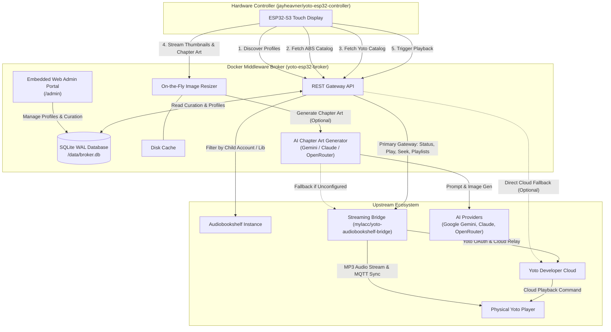

# System Architecture & Implementation Blueprint: Hybrid ESP32 Yoto & Audiobookshelf Controller

## 1. Executive Summary & Upstream Lineage
This project designs and integrates an open-source, community-shareable hardware/software appliance enabling children to browse their self-hosted **Audiobookshelf (ABS)** library (filtered by child tags) alongside **native Yoto playlists/cards** from an **ESP32-S3 touchscreen display** and stream the selected content directly to physical Yoto players.

### Upstream Foundation Projects:
1. **Hardware / Controller Dashboard Foundation:**
   * **Upstream:** [jayheavner/yoto-esp32-controller](https://github.com/jayheavner/yoto-esp32-controller)
   * **Role:** Provides the base ESP32-S3 firmware, LVGL UI layout, 800×480 display timing, GT911 touch driver, 3D printable enclosure, night clock screensaver, and NVS web settings portal.
2. **Audio Streaming & 2-Way Progress Sync Foundation:**
   * **Upstream:** [mylacc/yoto-audiobookshelf-bridge](https://github.com/mylacc/yoto-audiobookshelf-bridge)
   * **Role:** Serves as the real-time audio streaming engine. Transcodes ABS audiobooks on-the-fly to constant-bitrate MP3 via `ffmpeg`, delivers streams to Yoto players, and captures MQTT telemetry events to synchronize playback progress back into Audiobookshelf per-user.
3. **Middleware Broker Layer (`yoto-esp32-broker`):**
   * **Role:** The decoupled microservice connecting the ESP32 dashboard to Audiobookshelf and the streaming bridge, delivering lightweight JSON payloads, tag/library/child-account scoping, disk-cached 100×100px thumbnails, an embedded **SQLite (WAL mode)** relational data store, and a centralized **Web Admin Curation Dashboard**.
4. **Relational SQLite Persistence & Web Admin Portal:**
   * **Role:** Replaces raw JSON editing with an ACID-compliant embedded database (`/data/broker.db`). Powers first-run onboarding, multi-user authentication, proxy SSO pass-through (Authentik / Cloudflare Access), dynamic entity discovery, many-to-many catalog curation, and seasonal highlight pinning.
5. **Optional Multi-Platform AI Chapter Artwork Engine:**
   * **Role:** Generates age-appropriate chapter illustrations for Audiobookshelf books using **Google Gemini**, **Anthropic Claude**, or **OpenRouter**.
   * **Fallback Hierarchy:** If AI generation is disabled, unconfigured, or fails, the broker seamlessly falls back to the Yoto ABS Bridge chapter icon (`/api/cards/<slot>/icon/preview` or pixel art). If no bridge icon exists, it falls back to the parent book's ABS cover art.



---

## 2. Shareable Open-Source Architecture Rules

To ensure this project can be freely cloned, forked, and deployed by anyone in the home automation and self-hosting community without leaking private data or breaking upstream behavior:

1. **Non-Breaking & Additive Extension Standard:**
   * **Preserve Creator's Original Purpose:** All enhancements (ABS library browsing, multi-child profiles, thumbnail proxying, AI chapter art) are strictly **optional and non-breaking**.
   * **Pure Yoto-Only Operation:** If a user does not use Audiobookshelf (or leaves `ABS_API_KEY` blank), the broker and firmware operate seamlessly in pure Yoto mode. No ABS errors are logged, no broken requests are sent, and the firmware automatically hides the ABS tab to match the creator's original single-grid Yoto experience.
   * **Optional AI Generation with Bridge Fallback:** The AI chapter generation module is disabled by default (`AI_CHAPTER_ART_ENABLED=false`). When disabled or missing an API key, the broker transparently pulls chapter artwork from the running `yoto-audiobookshelf-bridge` instance or serves the book's primary cover art.
   * **Standalone Firmware Fallback:** The firmware retains the original direct-to-cloud Yoto client logic for users who prefer not to deploy the Docker broker.
2. **Zero Hardcoded Identifiers:**
   * No personal names, child usernames, hardware MAC/IP addresses, internal homelab domain names, or physical device serials exist in any source code.
   * All entity associations (child profiles, tags, and Yoto player IDs) are strictly read from `config.json` and `.env`.
3. **Explicit Sample Configurations:**
   * `config.example.json` and `.env.example` provide clear, documented placeholders (`child_one`, `child_two`, `y2_sample_player_id_1`).
4. **Strict Git Ignore Strategy:**
   * All runtime databases, generated thumbnails, user credentials, and active configuration files are permanently excluded from Git tracking.
5. **Security, Access Control & Child Safety Core Standard:**
   * **Child Content Safety Guardrails:** Strict negative prompting and child-safe instructions on all AI image generation. Parents retain manual icon override capability in the admin dashboard.
   * **SSO Proxy Validation:** Reverse-proxy authentication headers (`X-authentik-username`, etc.) are honored exclusively from explicitly whitelisted `TRUSTED_PROXIES` subnets to prevent header forgery.
   * **Device Pairing Quarantine:** Newly discovered ESP32 displays enter a pending quarantine state until an administrator pairs and approves them in the admin portal.
   * **SSRF & Input Sanitization:** Image proxy requests are restricted to discrete dimensions (`100x100`, `200x200`) and validated against trusted image origins (`*.yotoplay.com`, `*.yoto.io`, local ABS server).
   * **Secret Masking:** Diagnostics and health probes never echo raw API tokens, client secrets, or OAuth credentials.

---

## 3. Data Flow & Interaction Lifecycle

### Phase 1: Controller Boot, Zero-Config Handshake & Profile Resolution
1. The ESP32 boots, initializes the 800×480 RGB panel and GT911 touch driver, and connects to local Wi-Fi.
2. The controller performs **mDNS Discovery** (`_yoto-broker._tcp.local`) to dynamically resolve the broker's LAN IP.
3. The controller executes a self-announcement handshake via `POST /api/devices/register`, transmitting its MAC address, IP, and firmware version.
4. **Quarantine & Approval Gate:** If the device is not yet approved in SQLite (`is_approved = 0`), the screen prompts the parent to approve the new display in the Admin Portal.
5. Once approved, the controller calls `GET /api/device/config?device_id=MAC`:
   * **Assigned Default Mode:** If the administrator assigned a default profile to this hardware, the controller bypasses Screen 1 and opens immediately into that child's personalized catalog.
   * **Shared Display Mode:** If unassigned and 2+ profiles exist, the controller displays the profile landing screen allowing the child to tap their avatar.
6. The active profile ID is persisted to ESP32 Non-Volatile Storage (NVS). On all subsequent screens, an avatar badge in the navigation header allows switching to an alternate profile at any time.

### Phase 2: Catalog Browsing & Thumbnail Hydration
1. When a child opens the catalog, the ESP32 presents two tabs:
   * **Audiobooks:** Fetched via `GET /api/kids/<profile>/abs`. The broker queries Audiobookshelf, extracts books tagged with the child's tag, strips heavy metadata, and returns minimal arrays: `[{"id", "type", "title", "author", "thumb"}]`.
   * **Yoto Cards:** Fetched via `GET /api/kids/<profile>/yoto`. The broker queries the Yoto Developer API for the family library and returns the identical lightweight schema.
2. The ESP32 renders a scrollable grid of cards.
3. For each visible card, the ESP32 requests cover art from `GET /api/thumb?type=...&id=...&size=100`.
4. The broker checks its local disk cache. If missing, it downloads the full-resolution artwork, center-crops it into a 1:1 square, downscales it to 100×100px via Pillow Lanczos resampling, compresses it as an 80% quality JPEG, saves it to disk, and streams it to the ESP32.
5. This limits memory usage on the ESP32 to less than 10 KB per cover image.

### Phase 2.5: Detail View & Chapter Artwork (Optional Multi-Platform AI Engine)
1. When a child taps a book to view its chapters/tracks, the ESP32 requests chapter thumbnails via `GET /api/thumb?type=abs_chapter&id=<book_id>&chapter=<n>&size=100`.
2. The broker resolves chapter metadata (title, duration, start offset) from Audiobookshelf.
3. If AI chapter art is enabled (`AI_CHAPTER_ART_ENABLED=true`):
   * Checks the local cache at `/app/cache/ai_chapters/<hash>.jpg`.
   * If not cached, the broker passes the book title, author, and chapter title to the configured provider:
     * **Google Gemini:** `gemini-2.5-flash` creates structured prompts for Imagen or returns generative art descriptions.
     * **Anthropic Claude:** Generates kid-safe palette grids or prompt instructions via Anthropic's Messages API.
     * **OpenRouter:** Dispatches prompts to any multimodal or image model (e.g., FLUX, SDXL, DALL-E) using OpenAI-compatible endpoints.
   * Prompts strictly enforce age-appropriateness, kid-safe themes (no scary, dark, or violent content), and square 1:1 format.
4. **Graceful Fallback Pipeline:**
   * If AI is disabled, unconfigured, or an API error occurs:
     * The broker queries the local Yoto ↔ Audiobookshelf Bridge (`GET http://yoto-bridge:8080/api/cards/<slot>/icon/preview` or pixel art icon).
     * If no bridge icon is available, the broker falls back to the parent book's primary cover art.
5. In all cases, the final image is processed by Pillow (100×100px JPEG, 80% quality) and cached locally on disk.

### Phase 3: Tap-to-Play Execution
1. The child taps a book cover or chapter on the display.
2. The ESP32 posts a lightweight command:
   ```json
   POST /api/play
   {
     "child": "child_one",
     "type": "abs",
     "id": "book_uuid_12345",
     "chapter": 1
   }
   ```
3. The broker resolves the child's default Yoto player hardware ID and dedicated ABS API key from SQLite.
4. **For Native Yoto Cards:** The broker calls Yoto's Cloud API (`POST /device-v2/{deviceId}/command/card/start`), directing the player to begin streaming.
5. **For Audiobookshelf Books:** The broker routes the command through the local Yoto ↔ ABS Bridge, which initializes ffmpeg transcoding and streams the audiobook to the player, updating progress per child.
6. The ESP32 transitions to a "Now Playing" view showing playback controls and cover art.

---

## 4. Repository Structure & Documentation Hierarchy

All technical and architectural documentation is stored in this repository:

```text
yoto-esp32-broker/
├── README.md                      # Project landing page & quickstart
├── ARCHITECTURE_AND_PLAN.md       # High-level architecture & system design (this document)
├── config.example.json            # Generic sample profile configuration (bootstrap)
├── docs/
│   ├── API_SPECIFICATION.md       # Master REST API catalog across all 8 functional areas
│   ├── FIRMWARE_SPECIFICATION.md  # ESP32-S3 hardware notes, LVGL UI layout & setup
│   ├── DEPLOYMENT_GUIDE.md        # Docker Compose setup, security & reverse proxy
│   └── features/                  # Granular Design Lifecycle Documents (DLP 001 - 012)
│       ├── 001-broker_chapter_metadata_and_batch_pregen.md
│       ├── 002-live_telemetry_and_now_playing_api.md
│       ├── 003-esp32_firmware_profile_selection.md
│       ├── 004-esp32_firmware_adaptive_catalog_tabs.md
│       ├── 005-esp32_firmware_chapter_browser_and_detail_view.md
│       ├── 006-esp32_firmware_now_playing_screen.md
│       ├── 007-esp32_hardware_display_and_power_management.md
│       ├── 008-home_assistant_mqtt_discovery_and_bedtime_lock.md
│       ├── 009-broker_web_admin_dashboard.md
│       ├── 010-broker_managed_remote_ota_and_rollback.md
│       ├── 011-curation_matrix_mass_edit_and_bulk_permissions.md
│       └── 012-tracklist_browser_and_chapter_artwork_studio.md
└── sample app/                    # Reference implementation of the Python broker
    ├── app.py                     # Flask service with SQLite WAL integration
    ├── ai_service.py              # Multi-platform AI chapter artwork engine
    ├── Dockerfile                 # Container packaging with healthcheck
    ├── docker-compose.yml         # Self-hosted stack manifest
    ├── requirements.txt           # Python dependencies
    ├── .env.example               # Environment variables template
    └── config.example.json        # Profile bootstrap seed
```
