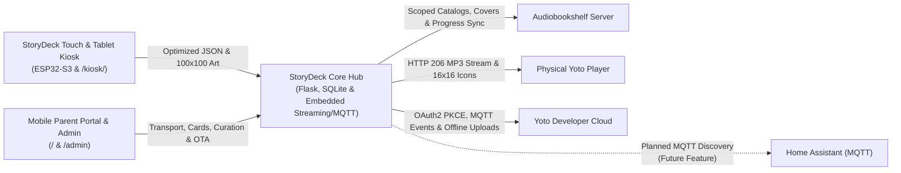

# StoryDeck Core

An open-source, community-ready smart hub and middleware broker that connects children's hardware companion controllers ([**StoryDeck Touch**](https://github.com/YotoStoryDeck/touch)), **Audiobookshelf (ABS)** audio libraries, and physical **Yoto Players**.

StoryDeck Core unifies real-time MQTT telemetry, on-the-fly MP3 streaming, offline Yoto playlist uploads, catalog curation, multi-child profiles, thumbnail downscaling, remote Touch OTA firmware updates, and a mobile-first Parent Portal inside a single container.

---

## 🧩 Architecture Lineage & Foundations

StoryDeck Core integrates and builds upon foundational work from the open-source community:

1. **Hardware & Touchscreen Appliance:**
   * **Upstream:** [jayheavner/yoto-esp32-controller](https://github.com/jayheavner/yoto-esp32-controller)
   * **Attribution:** Created the original ESP32-S3 firmware, LVGL UI architecture, and 3D printable bedside enclosure for the Waveshare 4.3" panel.
2. **Audio Streaming & Two-Way Progress Sync (Now Integrated into Core):**
   * **Upstream:** [mylacc/yoto-audiobookshelf-bridge](https://github.com/mylacc/yoto-audiobookshelf-bridge)
   * **Attribution:** Pioneered the dynamic `ffmpeg` HTTP 206 MP3 streaming architecture, silence-snapped chapter splitting, offline track uploading, and MQTT bidirectional Audiobookshelf progress sync now integrated directly inside StoryDeck Core (`core/bridge/`).
3. **StoryDeck Core (This Hub):**
   * **Role:** Single-container orchestration server combining embedded Yoto Cloud streaming & MQTT telemetry with a 4-tab Mobile Parent Portal (`/`), microcontroller-optimized JSON APIs, tag/series curation, multi-child profiles, travel proximity detection, device quarantine, and remote OTA firmware management.



---

## 🚀 Key Features

* **4-Tab Mobile Parent Portal (`/`):** Responsive bedside control center with Player telemetry & transport controls (scrub seek, `±30s`, speed, sleep timers, capped `volume_max`, Continue Listening), scoped Library browser, Primary & Fleet Card switcher (`Streaming` ↔ `Offline`), Yoto Cloud playlist manager, and automatic OAuth lockout protection.
* **Consolidated Streaming & Native MQTT Engine:** Embedded `ffmpeg` 64kbps mono HTTP `206` MP3 streamer, silence-snapped chapter cuts (`QuietSpots`), offline Yoto Cloud playlist uploads with warm SHA reuse & series-aware LRU pruning, native `YotoMqttBridge` telemetry, and bi-directional Audiobookshelf progress sync (`PlaybackManager`).
* **Microcontroller-Optimized APIs & Integrated Tablet Kiosk:** Tailored endpoints serving compact JSON payloads, 100×100 JPEG thumbnails for ESP32-S3 Touch displays, and a zero-dependency web companion at `/kiosk/`.
* **Multi-Child Profiles & Curation Matrix:** Separate libraries, ABS user scoping, daily discovery limits, physical card ownership tracking (`has_physical`), atomic whole-series rotation, and manual **Yoto Card Series & Sequence Overrides**.
* **Device Registration & Remote OTA Firmware Management:** Native zero-PIN hardware onboarding, automatic quarantine, rotating per-device JWTs, Core-hosted firmware repository with 1-click push/rollback OTA updates, and remote Touch MicroSD cache maintenance.
* **Network Proximity & Travel Protection:** Automatically detects whether a Yoto player is on the home network or traveling away, disarming bedtime sleep timers to protect roaming players.

### 🔮 Planned / Future Features
* **Home Assistant MQTT Integration:** Automatic entity discovery for bedtime screen locks, now-playing sensors, and automation switches.
* **Multi-Interval Bedtime & OK-to-Wake Schedules:** Core-synced weekday/weekend schedule overrides for bedside controllers.

---

## 🛠️ Quick Start & Deployment

### Option 1: Docker

Run StoryDeck Core directly using official container images from GitHub Container Registry (GHCR):

1. **Create an application directory, `.env`, and `docker-compose.yml`:**
   ```yaml
   services:
     storydeck-core:
       # For latest stable production release:
       image: ghcr.io/yotostorydeck/core:latest
       # For specific releases or dev builds, specify the tag:
       # image: ghcr.io/yotostorydeck/core:v1.1.0
       # image: ghcr.io/yotostorydeck/core:dev
       container_name: storydeck-core
       restart: unless-stopped
       ports:
         - "${PORT:-5055}:5055"
       env_file:
         - .env
       volumes:
         - ./data:/app/data
         - ./cache:/app/cache
   ```

2. **Launch the container:**
   ```bash
   docker compose up -d
   ```

---

### Option 2: Local Development (Python 3.10+)

For local development and testing:

```bash
git clone https://github.com/YotoStoryDeck/core.git
cd core
python -m venv venv

# Windows PowerShell:
.\venv\Scripts\Activate.ps1
# Linux / macOS:
# source venv/bin/activate

pip install -r requirements.txt
cp .env.example .env
# Edit .env (set SECRET_KEY and optional initial credentials)
python app.py
```

Once running, StoryDeck Core will be available at `http://localhost:5055`:
* **Mobile Parent Portal:** `http://localhost:5055/`
* **Admin Dashboard:** `http://localhost:5055/admin` *(opens `/admin/setup` on first boot)*
* **Tablet Kiosk:** `http://localhost:5055/kiosk/` *(Fully self-contained in `static/kiosk/` — zero external asset dependencies; runs edge-to-edge on iPads, Android tablets, Fire OS, and desktop browsers).*

---

## 🤖 AI Development Notice

This project utilizes artificial intelligence (AI) tools, including Anthropic Claude and Google Gemini / Antigravity, to assist in architectural design, code generation, refactoring, test suite development, and technical documentation. All AI-assisted contributions are human-reviewed, audited, and tested against live and simulated hardware.

---

## 📜 Credits & Acknowledgments

* **Jay Heavner** ([@jayheavner](https://github.com/jayheavner)) for the original [yoto-esp32-controller](https://github.com/jayheavner/yoto-esp32-controller), hardware schematics, and touchscreen UI patterns.
* **Mylacc** ([@mylacc](https://github.com/mylacc)) for the pioneering [yoto-audiobookshelf-bridge](https://github.com/mylacc/yoto-audiobookshelf-bridge) streaming and progress synchronization engine.
* **The Yoto Community** for reverse-engineering and documenting the Yoto API ecosystem.

---

## 📄 License

This project is licensed under the [MIT License](LICENSE).
