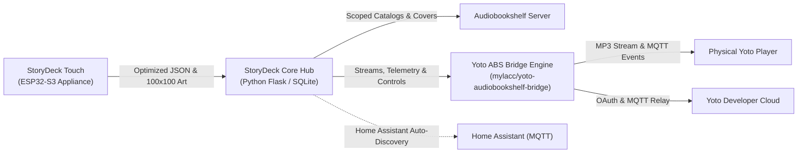

# StoryDeck Core

An open-source, community-ready smart hub and middleware broker that bridges children's hardware companion controllers ([**StoryDeck Touch**](https://github.com/YotoStoryDeck/touch)), **Audiobookshelf (ABS)** audio libraries, and physical **Yoto Players**.

StoryDeck Core manages real-time playback state synchronization, catalog curation, multi-child profiles, thumbnail downscaling, and Home Assistant automation integration.

---

## 🧩 Architecture Lineage & Foundations

StoryDeck Core unifies and builds upon foundational work from the open-source community:

1. **Hardware & Touchscreen Appliance:**
   * **Upstream:** [jayheavner/yoto-esp32-controller](https://github.com/jayheavner/yoto-esp32-controller)
   * **Attribution:** Created the original ESP32-S3 firmware, UI architecture, and 3D printable bedside enclosure for the Waveshare 4.3" panel.
2. **Audio Streaming & Two-Way Progress Sync:**
   * **Upstream:** [mylacc/yoto-audiobookshelf-bridge](https://github.com/mylacc/yoto-audiobookshelf-bridge)
   * **Attribution:** Created the core Yoto/Audiobookshelf streaming engine, dynamic on-the-fly MP3 transcoding via `ffmpeg`, and MQTT bidirectional progress sync.
3. **StoryDeck Core (This Hub):**
   * **Role:** Central coordinator providing microcontroller-optimized JSON APIs, tag-based parental curation, multi-child profile switching, live device telemetry, Home Assistant MQTT discovery, device pairing, and firmware OTA management.



---

## 🚀 Key Features

* **Microcontroller-Optimized APIs:** Tailored endpoints serving compact JSON payloads and streaming 100×100 JPEG thumbnails formatted specifically for low-RAM microcontrollers.
* **Integrated Web Companion / Simulator:** Built-in web kiosk accessible at `/kiosk/` and `/simulator/` for tablets, phones, and wall-mounted dashboards without external dependencies.
* **Multi-Child Profiles:** Separate libraries and preferences per child or room, with support for instant profile switching.
* **Tag-Based Content Filtering:** Filter Audiobookshelf audiobooks and Yoto playlists by age, child tag, or collection.
* **Live Telemetry & Remote Transport:** Real-time playback status, volume controls honoring native Yoto day/night limits, track progress, and chapter markers.
* **Network Proximity & Travel Protection:** Automatically detects whether a Yoto player is on the local home network or traveling away on mobile hotspot/hotel Wi-Fi, disarming bedtime sleep timers to prevent accidental remote interruptions.
* **Home Assistant MQTT Discovery:** Automatic entity discovery for bedtime screen locks, now-playing sensors, and automation switches.
* **Device Pairing & Management:** Simple PIN pairing for StoryDeck Touch controllers without exposing raw cloud credentials to bedside devices.
* **Remote OTA Updates:** Distribute and manage firmware updates for StoryDeck Touch directly from the Core Web Admin.

---

## 🛠️ Quick Start (Local & Docker)

### Run via Docker Compose
```bash
git clone https://github.com/YotoStoryDeck/core.git
cd core
cp .env.example .env
# Edit .env with your Audiobookshelf and Yoto credentials
docker compose up -d
```

### Run Locally (Python 3.12)
```bash
git clone https://github.com/YotoStoryDeck/core.git
cd core
python -m venv venv
.\venv\Scripts\activate
pip install -r requirements.txt
python app.py
```

Core will be available at `http://localhost:5055`. Access `/admin` for the management dashboard and `/simulator/` (or `/kiosk/`) for the touch companion interface.

---

## 📜 Credits & Acknowledgments

* **Jay Heavner** ([@jayheavner](https://github.com/jayheavner)) for the original [yoto-esp32-controller](https://github.com/jayheavner/yoto-esp32-controller), hardware schematics, and touchscreen UI patterns.
* **Mylacc** ([@mylacc](https://github.com/mylacc)) for the pioneering [yoto-audiobookshelf-bridge](https://github.com/mylacc/yoto-audiobookshelf-bridge) streaming and progress synchronization engine.
* **The Yoto Community** for reverse-engineering and documenting the Yoto API ecosystem.

---

## 📄 License

This project is licensed under the [MIT License](LICENSE).
