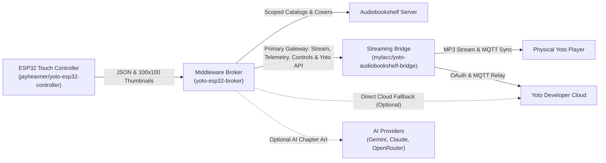

# Hybrid ESP32 Yoto & Audiobookshelf Controller

An open-source, community-ready hardware and software ecosystem allowing children to browse self-hosted **Audiobookshelf (ABS)** audiobooks and **native Yoto playlists** from a bedside **ESP32-S3 touchscreen display** and trigger playback on their physical Yoto players.

---

## 🧩 Upstream Foundations & Architecture Lineage

This ecosystem unifies and builds upon two open-source foundations:

1. **Hardware & Touchscreen Dashboard:**
   * **Upstream Project:** [jayheavner/yoto-esp32-controller](https://github.com/jayheavner/yoto-esp32-controller)
   * **Role:** Serves as the base firmware, UI layout, and hardware target (Waveshare ESP32-S3-Touch-LCD-4.3B 800×480 IPS display, GT911 touch, 3D printable wall enclosure, night-clock screensaver, and NVS web settings portal).
2. **Audio Streaming & 2-Way Progress Sync Engine:**
   * **Upstream Project:** [mylacc/yoto-audiobookshelf-bridge](https://github.com/mylacc/yoto-audiobookshelf-bridge)
   * **Role:** Serves as the core audio bridge. Streams Audiobookshelf audiobooks dynamically to Yoto players as constant-bitrate MP3 via `ffmpeg`, and synchronizes real-time playback progress back into Audiobookshelf per-user via Yoto MQTT events.
3. **This Project (`yoto-esp32-broker`):**
   * **Role:** The lightweight middleware broker that bridges the ESP32 controller to both Audiobookshelf and the Yoto streaming bridge, handling tag filtering, multi-child profiles, thumbnail downscaling, unified playback dispatching, and an optional **multi-platform AI chapter artwork engine** (Gemini, Claude, OpenRouter) with seamless fallback to Yoto ABS Bridge icons.

---

## 📚 Project Documentation Index

All architectural blueprints, API schemas, hardware wiring details, and deployment guides are available in this repository:

1. [**System Architecture & Implementation Blueprint**](ARCHITECTURE_AND_PLAN.md):
   * End-to-end design, data flow lifecycle, sequence diagrams, and open-source isolation rules.
2. [**REST API Specification**](docs/API_SPECIFICATION.md):
   * Microcontroller-optimized JSON schemas, profile discovery, tag filtering, on-the-fly 100x100 thumbnail resizer, and unified playback dispatch.
3. [**ESP32 Firmware Blueprint**](docs/FIRMWARE_SPECIFICATION.md):
   * Waveshare ESP32-S3-Touch-LCD-4.3B hardware rules (16 MHz RGB pixel clock, PSRAM bounce buffer, GT911 touch, CH422G expander), LVGL multi-screen flow, child profile selector, and zero-cloud RAM optimization.
4. [**Deployment & Operations Guide**](docs/DEPLOYMENT_GUIDE.md):
   * Docker Compose deployment, environment variable configuration, generic profile mapping (`config.json`), and validation testing.
5. [**Engineering Master Roadmap**](ROADMAP.md):
   * Phased development roadmap across all 10 features, architecture dependencies, milestone deliverables, and security guardrails.

### 🌟 Detailed Feature Specifications (`docs/features/`)
Each individual subsystem and feature is exhaustively documented in our design lifecycle specifications:
* [**`001-broker_chapter_metadata_and_batch_pregen`**](docs/features/001-broker_chapter_metadata_and_batch_pregen.md): Lightweight chapter metadata API & async background AI batch pre-generator.
* [**`002-live_telemetry_and_now_playing_api`**](docs/features/002-live_telemetry_and_now_playing_api.md): Aggregated Yoto MQTT / Bridge state telemetry & remote controls with parental volume limits.
* [**`003-esp32_firmware_profile_selection`**](docs/features/003-esp32_firmware_profile_selection.md): Screen 1 multi-child landing screen, NVS persistence, zero-profile bypass, and profile switching badge.
* [**`004-esp32_firmware_adaptive_catalog_tabs`**](docs/features/004-esp32_firmware_adaptive_catalog_tabs.md): Screen 2 adaptive dual-tab catalog grid, 100x100 tiles, and streaming TJpgDec PSRAM decoding.
* [**`005-esp32_firmware_chapter_browser_and_detail_view`**](docs/features/005-esp32_firmware_chapter_browser_and_detail_view.md): Screen 3 book detail overlay, scrollable chapter list with 16x16 pixel art icons, and playback dispatch.
* [**`006-esp32_firmware_now_playing_screen`**](docs/features/006-esp32_firmware_now_playing_screen.md): Screen 4 bedside Now Playing dashboard with progress bar, transport controls, and volume slider.
* [**`007-esp32_hardware_display_and_power_management`**](docs/features/007-esp32_hardware_display_and_power_management.md): Waveshare 4.3" 16 MHz pixel clock, DMA burst settings, SRAM draw buffers, and amber night clock screensaver.
* [**`008-home_assistant_mqtt_discovery_and_bedtime_lock`**](docs/features/008-home_assistant_mqtt_discovery_and_bedtime_lock.md): Home Assistant MQTT auto-discovery, remote bedtime screen lock switch, and playback sensors.
* [**`009-broker_web_admin_dashboard`**](docs/features/009-broker_web_admin_dashboard.md): Centralized web admin portal with proxy SSO / Basic Auth, profile CRUD, live entity discovery, unified catalog matrix grid with seasonal highlights, and live connection diagnostics.
* [**`010-broker_managed_remote_ota_and_rollback`**](docs/features/010-broker_managed_remote_ota_and_rollback.md): Centralized firmware binary storage, 1-click remote OTA upgrades from the Web Admin UI, SHA-256 verification, and automated/manual partition version rollback.
* [**`011-curation_matrix_mass_edit_and_bulk_permissions`**](docs/features/011-curation_matrix_mass_edit_and_bulk_permissions.md): Multi-card selection, docked floating bulk action bar, mass edit permissions modal, and atomic SQLite batch permission endpoints.
* [**`012-tracklist_browser_and_chapter_artwork_studio`**](docs/features/012-tracklist_browser_and_chapter_artwork_studio.md): Card tracklist browser modal, read-only retail inspection, editable ABS/MYO chapter pixel art, 1-click auto-match, and manual community icon picker.
* [**`013-api_security_tokens_and_per_device_jwt_architecture`**](docs/features/013-api_security_tokens_and_per_device_jwt_architecture.md): Master API keys for Bridge & Broker, preserved WAN streaming, and per-device rotating JWTs with instant hardware revocation.

---

## 🚀 Quick Reference

### Sample Configuration & Persistence Files
* [`config.example.json`](config.example.json): Generic child profiles, tags, and Yoto player ID bootstrap template (auto-migrated to SQLite on first boot).
* [`sample app/.env.example`](sample%20app/.env.example): Environment variable template for Audiobookshelf, Yoto credentials, and Admin authentication.
* [`sample app/`](sample%20app/): Python microservice implementation with embedded SQLite database (`/data/broker.db`).

---

## 🔒 Open Source & Community Standard
This repository is strictly designed with **zero hardcoded personal identifiers**. No personal names, device serials, internal IP addresses, or private tokens are stored in the codebase. All runtime associations are persisted locally in SQLite (`/data/broker.db`) with bootstrap injection via `.env` and `config.json`.
