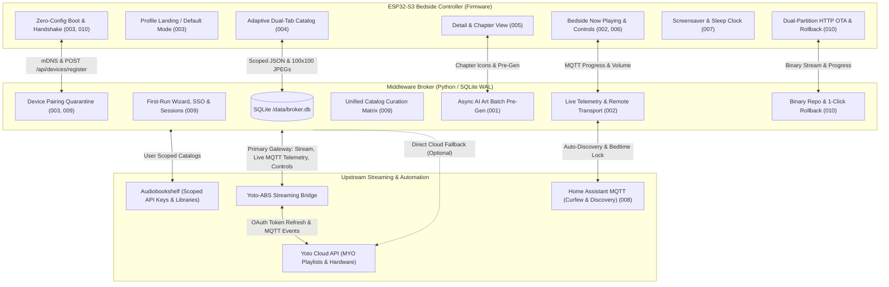

# Engineering Roadmap: Yoto & Audiobookshelf ESP32 Controller Ecosystem

**Ecosystem Components:**
* **Middleware Broker:** [`yoto-esp32-broker`](https://github.com/alicia86/projects/tree/main/yoto-esp32-broker) (Python Flask / SQLite WAL / Gunicorn)
* **Bedside Touchscreen Controller:** [`yoto-esp32-controller`](https://github.com/jayheavner/yoto-esp32-controller) (ESP32-S3 / Waveshare 4.3" 800×480 IPS / LVGL v8)
* **Audio Streaming Bridge:** [`yoto-audiobookshelf-bridge`](https://github.com/mylacc/yoto-audiobookshelf-bridge) (Go / Docker / FFmpeg / MQTT)

---

## 🗺️ Master Ecosystem Architecture

---

## 📑 Feature Matrix & Status Overview

| DLP ID | Feature Title | Target Component | Status | Specifications |
| :--- | :--- | :--- | :--- | :--- |
| [**001**](docs/features/001-broker_chapter_metadata_and_batch_pregen.md) | Chapter Metadata API & Async Batch Pre-Gen | Broker Core & AI Engine | Approved / Seed Implemented | [`001-spec`](docs/features/001-broker_chapter_metadata_and_batch_pregen.md) |
| [**002**](docs/features/002-live_telemetry_and_now_playing_api.md) | Live Telemetry & Bedside Remote Controls | Broker Telemetry & Firm. | Approved / Seed Implemented | [`002-spec`](docs/features/002-live_telemetry_and_now_playing_api.md) |
| [**003**](docs/features/003-esp32_firmware_profile_selection.md) | Profile Selection, Device Defaults & Switcher | ESP32 Screen 1 & Broker | Approved / Documented | [`003-spec`](docs/features/003-esp32_firmware_profile_selection.md) |
| [**004**](docs/features/004-esp32_firmware_adaptive_catalog_tabs.md) | Adaptive Dual Catalog & Seasonal Highlights | ESP32 Screen 2 & Broker | Approved / Seed Implemented | [`004-spec`](docs/features/004-esp32_firmware_adaptive_catalog_tabs.md) |
| [**005**](docs/features/005-esp32_firmware_chapter_browser_and_detail_view.md) | Chapter Browser, 16×16 Art & Dispatch | ESP32 Screen 3 & Broker | Approved / Documented | [`005-spec`](docs/features/005-esp32_firmware_chapter_browser_and_detail_view.md) |
| [**006**](docs/features/006-esp32_firmware_now_playing_screen.md) | Bedside Now Playing Dashboard & Slider | ESP32 Screen 4 & Firm. | Approved / Documented | [`006-spec`](docs/features/006-esp32_firmware_now_playing_screen.md) |
| [**007**](docs/features/007-esp32_hardware_display_and_power_management.md) | 16 MHz Clock, PSRAM Buffers & Night Clock | ESP32 Hardware & Driver | Approved / Validated Upstream | [`007-spec`](docs/features/007-esp32_hardware_display_and_power_management.md) |
| [**008**](docs/features/008-home_assistant_mqtt_discovery_and_bedtime_lock.md) | Home Assistant MQTT & Bedtime Curfew Lock | Broker HA Integration | Approved / Documented | [`008-spec`](docs/features/008-home_assistant_mqtt_discovery_and_bedtime_lock.md) |
| [**009**](docs/features/009-broker_web_admin_dashboard.md) | Web Admin Portal, SQLite WAL & SSO Protection | Broker Web UI & DB | Approved / In Implementation | [`009-spec`](docs/features/009-broker_web_admin_dashboard.md) |
| [**010**](docs/features/010-broker_managed_remote_ota_and_rollback.md) | Remote OTA Updates & Dual-Partition Rollback | Broker Repo & ESP32 OTA | Approved / Documented | [`010-spec`](docs/features/010-broker_managed_remote_ota_and_rollback.md) |
| [**011**](docs/features/011-curation_matrix_mass_edit_and_bulk_permissions.md) | Multi-Card Mass Edit & Bulk Profile Access | Broker Web UI & Curation | Approved / Implemented | [`011-spec`](docs/features/011-curation_matrix_mass_edit_and_bulk_permissions.md) |
| [**012**](docs/features/012-tracklist_browser_and_chapter_artwork_studio.md) | Tracklist Browser & Chapter Artwork Studio | Broker Web UI & Icon Engine | Approved / Implemented | [`012-spec`](docs/features/012-tracklist_browser_and_chapter_artwork_studio.md) |
| [**013**](docs/features/013-api_security_tokens_and_per_device_jwt_architecture.md) | Master API Tokens & Per-Device Rotating JWT Security | Broker, Bridge & ESP32 | Approved / Implemented | [`013-spec`](docs/features/013-api_security_tokens_and_per_device_jwt_architecture.md) |
---

## 🚀 Execution Phases & Milestones

### Phase 1: Broker Relational Core & Web Admin Portal
* **Primary Features:** [Feature 009](docs/features/009-broker_web_admin_dashboard.md), [Feature 001](docs/features/001-broker_chapter_metadata_and_batch_pregen.md), [Feature 004](docs/features/004-esp32_firmware_adaptive_catalog_tabs.md), [Feature 011](docs/features/011-curation_matrix_mass_edit_and_bulk_permissions.md), [Feature 012](docs/features/012-tracklist_browser_and_chapter_artwork_studio.md), [Feature 013](docs/features/013-api_security_tokens_and_per_device_jwt_architecture.md)
* **Deliverables:**
  1. `database.py`: SQLite initialization, WAL mode (`PRAGMA journal_mode = WAL;`), schema tables (`admin_users`, `profiles`, `media_items`, `profile_media_permissions`, `esp32_devices`, `firmware_releases`, `system_settings`), and first-boot migration from legacy `config.json`.
  2. First-Run Setup Wizard (`/admin/setup`): PBKDF2/Argon2id password hashing, permanent setup closure.
  3. Reverse-Proxy SSO Gate: `TRUSTED_PROXIES` header inspection for Authentik / Cloudflare Access.
  4. Catalog Curation Matrix UI: Unified table view of all Yoto family cards and ABS audiobooks, per-child allow/exclude toggles, seasonal "Highlight" pinning, and title regex rules.
  5. Multi-Card Mass Edit & Bulk Permissions ([Feature 011](docs/features/011-curation_matrix_mass_edit_and_bulk_permissions.md)): Row checkboxes, shift-click range selection, floating bulk action bar, mass edit permissions modal, and atomic SQLite transaction endpoints.
  6. Tracklist Browser & Chapter Artwork Studio ([Feature 012](docs/features/012-tracklist_browser_and_chapter_artwork_studio.md)): Interactive card tracklist modal, read-only retail inspection, editable ABS/MYO chapter pixel art with 1-click auto-matching and manual MYO Studio-style icon search/picker.
  7. Master API Security & Per-Device Rotating JWTs ([Feature 013](docs/features/013-api_security_tokens_and_per_device_jwt_architecture.md)): Native 32-character hex API keys for Bridge and Broker (`X-Api-Key`), 1-click key regeneration, preserved open public audio streaming (`/s/*`), and per-device rotating JWTs (24h access / 30d refresh) with instant hardware quarantine revocation.
  8. Live Diagnostics Tab: Real-time API connection test buttons for Yoto OAuth, ABS server, and AI art providers.

### Phase 2: Microcontroller Device Lifecycle & Remote Management
* **Primary Features:** [Feature 003](docs/features/003-esp32_firmware_profile_selection.md), [Feature 009](docs/features/009-broker_web_admin_dashboard.md), [Feature 010](docs/features/010-broker_managed_remote_ota_and_rollback.md)
* **Deliverables:**
  1. Zero-Config Device Discovery: ESP32 mDNS advertiser (`_yoto-broker._tcp.local`) and self-announcement handshake (`POST /api/devices/register`).
  2. Hardware Quarantine Gate: Unapproved devices (`is_approved = 0`) are restricted from pulling catalogs until approved by an administrator in the Web Portal.
  3. Device Default Profile Assignment: Bind specific ESP32 controllers to dedicated children (bypassing Screen 1 on boot).
  4. Centralized Firmware Repository: Broker endpoints for binary upload (`/api/admin/firmware/upload`), version listing, and streaming delivery (`/api/firmware/<v>/firmware.bin`).
  5. 1-Click Remote Upgrades & Rollbacks: Admin-triggered updates with boot watchdog validation (`ESP_OTA_IMG_PENDING_VERIFY`) and automatic 15-second failover.

### Phase 3: Firmware UX Adaptation & Multi-Screen Flow
* **Primary Features:** [Feature 003](docs/features/003-esp32_firmware_profile_selection.md), [Feature 004](docs/features/004-esp32_firmware_adaptive_catalog_tabs.md), [Feature 005](docs/features/005-esp32_firmware_chapter_browser_and_detail_view.md), [Feature 006](docs/features/006-esp32_firmware_now_playing_screen.md), [Feature 007](docs/features/007-esp32_hardware_display_and_power_management.md)
* **Deliverables:**
  1. Upstream Fork Setup: Fork `jayheavner/yoto-esp32-controller` to `alicia86/yoto-esp32-controller`.
  2. Screen 1 (Profile Select): Card avatar buttons, auto-bypass for assigned devices, and persistent navigation header badge for alternate profile switching.
  3. Screen 2 (Adaptive Dual Grid): Segmented tabs for Audiobooks vs. Yoto Cards, auto-suppression when ABS is disabled, gold star pinned highlights row, and streaming `TJpgDec` PSRAM decoding.
  4. Screen 3 (Detail & Chapters): 16×16 pixel art icons (AI or bridge fallback), track duration formatting, and big "▶ Play on Bedroom Yoto" dispatch button.
  5. Screen 4 (Bedside Now Playing): Real-time progress bar, play/pause toggle, volume limit slider, and MQTT state sync.
  6. Ambient Screensaver: Amber night clock auto-dimming during bedtime hours.

### Phase 4: Upstream Ecosystem Sync & Home Assistant Automation
* **Primary Features:** [Feature 002](docs/features/002-live_telemetry_and_now_playing_api.md), [Feature 008](docs/features/008-home_assistant_mqtt_discovery_and_bedtime_lock.md)
* **Deliverables:**
  1. `yoto-audiobookshelf-bridge` Upstream PR / Push: Push tested Discord webhook notifications, healthcheck, and per-child progress sync modifications to `alicia86/yoto-audiobookshelf-bridge`.
  2. Home Assistant MQTT Auto-Discovery: Instant sensor creation for playback state, volume, active chapter, and child bedtime screen lock switch.
  3. Parental Bedtime Automation: Node-RED / Home Assistant blueprint to lock screens and fade volume automatically at 8:30 PM.

---

## 🔒 Safety, Security & Open-Source Guardrails

Across all implementation phases, the ecosystem strictly adheres to the **Open-Source Architectural Standard**:
1. **Zero Hardcoded Identifiers:** All personal names, device serials, internal IP addresses, and private tokens remain in local `.env` and `/data/broker.db`.
2. **Child Content Safety:** Strict negative prompting on all AI generative engines; manual parental icon override capability in the curation matrix.
3. **SSO Anti-Spoofing:** Reverse-proxy authentication headers (`X-authentik-username`) are only trusted from whitelisted `TRUSTED_PROXIES` subnets.
4. **Device Quarantine:** Discovered controllers must be explicitly paired and approved before accessing household catalogs.
5. **Fail-Safe Firmware Watchdog:** All OTA upgrades enforce dual-partition validation and automatic rollback to eliminate bricked bedside units.
