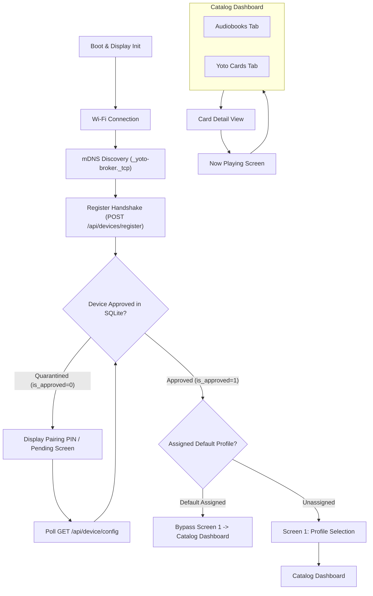

# ESP32-S3 Firmware Blueprint: Hybrid Yoto & Audiobookshelf Controller

## 1. Upstream Lineage & Hardware Specification

The controller firmware is directly adapted from **[jayheavner/yoto-esp32-controller](https://github.com/jayheavner/yoto-esp32-controller)**, extending Jay Heavner's standalone Yoto touchscreen dashboard to optionally query the local middleware broker for Audiobookshelf audiobooks and stream them via **[mylacc/yoto-audiobookshelf-bridge](https://github.com/mylacc/yoto-audiobookshelf-bridge)**.

The reference firmware targets the **[Waveshare ESP32-S3-Touch-LCD-4.3B](https://www.waveshare.com/wiki/ESP32-S3-Touch-LCD-4.3B)** (Rev 1.1) appliance board.

| Subsystem | Technical Specification | Engineering Rationale |
| :--- | :--- | :--- |
| **SoC Module** | **ESP32-S3-WROOM-1-N16R8** (Dual-core Xtensa LX7, 240 MHz) | Integrated 16 MB Flash + 8 MB OPI PSRAM. Ample computation for decoding JPEG streams and handling concurrent UI loops. |
| **Display** | 4.3\" 800×480 IPS RGB565 Parallel Panel (65K Colors) | Native landscape orientation, rich color depth, 60 Hz flicker-free refresh. |
| **Touch Controller** | Goodix GT911 (Capacitive I²C, `0x5D`/`0x14`) | 5-point touch responsive glass panel with origin at top-left and interrupt support. |
| **Memory** | 16 MB QIO Flash + **8 MB Octal (OPI) PSRAM** | High-speed PSRAM stores the 800×480 framebuffer and dynamic cover caches. |
| **I/O Expander** | CH422G (I²C `0x24`) | Drives LCD backlight (EXIO2), LCD reset (EXIO3), and touch reset (EXIO1). |
| **Real-Time Clock** | Onboard RTC chip with rechargeable backup battery | Preserves accurate bedside clock time through Wi-Fi drops and power interruptions without NTP lag. |
| **Power Supply** | Dual input: 5V USB Type-C **or 7~36V DC screw terminals** | Enables clean in-wall low-voltage wiring (12V/24V) or bedside USB-C wall adapters. Includes battery charging circuit (CHG/DONE/PWR LEDs). |
| **Peripherals & I/O** | External I²C terminal (3.3V/5V VOUT switchable), TF (MicroSD) slot, CAN, RS485, isolated digital I/O | The broken-out I²C header allows clean 4-wire hookup for an external NFC/RFID reader (PN532/MFRC522) without opening or soldering the board. TF slot provides local thumbnail caching. |
| **Connectivity** | 2.4 GHz Wi-Fi 802.11 b/g/n & BLE 5 | HTTP client queries local Docker broker over LAN. |
| **UI Framework** | LVGL (Light and Versatile Graphics Library) v8/v9 | Hardware-accelerated embedded widget framework. |

---

## 2. Hard-Won Board Driver Rules (Waveshare S3-4.3B)

To avoid known panel locking and DMA underrun bugs:

1. **RGB Pixel Clock: Exactly 16 MHz**
   * The panel will **not lock at 12 MHz** (resulting in a white screen). The RGB peripheral must be clocked at 16 MHz with `pclk_active_neg = 1`.
2. **Single Framebuffer + Bounce Buffer:**
   * Allocate a single framebuffer in PSRAM (`num_fbs = 1`). Double-framebuffer direct rendering exhibits PSRAM bandwidth thrashing during network operations.
   * Configure DMA burst flags to prevent left-edge scanline underruns:
     ```c
     cfg.dma_burst_size = 64;
     cfg.flags.bb_invalidate_cache = 1;
     ```
3. **LVGL Draw Buffer in Internal SRAM:**
   * Allocate the LVGL working draw buffer with `MALLOC_CAP_INTERNAL`. Rendering directly into fast internal SRAM is ~2× faster than PSRAM.
4. **CH422G Expander Sequence:**
   * Backlight control must be asserted on EXIO2 via I²C writes to register `0x24`.

---

## 3. Firmware Adaptation Roadmap (`jayheavner/yoto-esp32-controller` Fork)



### Phase 1: Zero-Config Discovery, Device Registration & Pairing Gate
1. **mDNS Service Discovery:**
   * Upon establishing Wi-Fi connectivity, the controller searches for `_yoto-broker._tcp.local` via mDNS, eliminating hardcoded broker IP requirements.
   * Falls back to user-configured static IP in NVS if mDNS resolution fails.
2. **Registration Handshake (`POST /api/devices/register`):**
   * Controller posts its MAC address, friendly board description, IP address, and firmware version to the broker.
3. **Quarantine & Pairing Gate:**
   * If the response indicates `is_approved: false`, the screen displays a polite pairing screen ("Controller Discovered! Please approve Oliver's Bedside Display in the Admin Portal at http://yoto-broker.local:5055/admin").
   * Controller polls `GET /api/device/config?device_id=MAC` every 5 seconds until approved by a parent.

### Screen 1: Profile Selection Landing Screen & Device Defaults (Optional)
* **Detailed Specification:** See [003-esp32_firmware_profile_selection.md](features/003-esp32_firmware_profile_selection.md).
* **Purpose:** Allows multiple children in the household to use the same physical controller, or automatically boot into a child's assigned dedicated bedside display.
* **Device-Assigned Default Mode:**
  * When an ESP32 is registered in the Admin Portal and assigned a default profile (e.g., "Oliver's Bedside Display" -> `child_one`), the controller queries `GET /api/device/config?device_id=MAC` on boot.
  * It detects the assigned profile, skips Screen 1, and opens directly into that child's catalog.
* **Shared Controller Mode (Unassigned):**
  * If no profile is pre-assigned to the device, the controller renders the visual landing screen with child avatar cards.
* **Always-Available Alternate Profile Switcher:**
  * Whenever 2+ profiles exist in the household, an avatar badge is displayed in the navigation header on all screens (Catalog, Detail, Now Playing).
  * Tapping this badge opens the profile switcher at any time, allowing siblings or parents to switch to an alternate profile on demand.

### Screen 2: Adaptive Catalog Grid & Seasonal Highlights
* **Detailed Specification:** See [004-esp32_firmware_adaptive_catalog_tabs.md](features/004-esp32_firmware_adaptive_catalog_tabs.md).
* **Non-Breaking Fallback (Original Creator Mode):**
  * If Audiobookshelf is not configured (`abs_enabled: false` from `/health`), the firmware **completely suppresses the tab bar**.
  * It renders the exact original single-source grid ("My Cards") from Jay Heavner's firmware, with zero visual clutter or non-functional ABS elements.
* **Dual-Source Mode (When ABS is Enabled):**
  * When both ABS and Yoto are active, a clean tab bar appears at the top:
    * **Tab 1: Yoto Cards** (Queries `/api/kids/<profile>/yoto`).
    * **Tab 2: Audiobooks (ABS)** (Queries `/api/kids/<profile>/abs`).
* **Seasonal "Highlights / Pinned" Shelf:**
  * Items flagged with `is_highlight: true` are pinned to the top row of the catalog grid (with a subtle gold or seasonal star badge).
* **Grid Layout:**
  * 4-column responsive grid of square cards.
  * Each card displays a 100×100px thumbnail with title below.
  * Thumbnails are streamed asynchronously from `/api/thumb?type=...&id=...&size=100` and decompressed directly into an LVGL canvas or image descriptor in PSRAM via `TJpgDec`.

### Screen 3: Detail & Chapter Browser View
* **Detailed Specification:** See [005-esp32_firmware_chapter_browser_and_detail_view.md](features/005-esp32_firmware_chapter_browser_and_detail_view.md).
* Tapping a cover opens an overlay with:
  * High-res cover view.
  * Title, Author, and total duration.
  * Big "▶ Play on Bedroom Yoto" dispatch button.
  * Scrollable chapter list with 16×16 pixel art icons (AI-generated or bridge icons) and track duration labels.

### Screen 4: Bedside Now Playing Dashboard
* **Detailed Specification:** See [006-esp32_firmware_now_playing_screen.md](features/006-esp32_firmware_now_playing_screen.md).
* Displays active book metadata, 100×100 cover art, current chapter title, progress bar, play/pause toggle, and parental volume slider.
* Real-time telemetry polled from `GET /api/kids/<profile>/now-playing`.
* Parental volume limits and bedtime curfew locks are enforced in real time via Home Assistant MQTT integration.

---

## 4. Network & Memory Optimization Guidelines

1. **Zero Cloud HTTPS on the ESP32:**
   * The original firmware negotiated TLS handshakes directly with AWS IoT and Yoto Cloud, which required massive contiguous internal SRAM buffers.
   * In this hybrid architecture, the ESP32 connects over plain HTTP directly to the local Docker broker on the home LAN, eliminating TLS heap fragmentation entirely.
2. **Streaming Chunked JPEG Decompression:**
   * Images are decoded using `TJpgDec` directly from the incoming HTTP stream into PSRAM memory buffers, keeping internal SRAM free for UI rendering.
3. **NVS Settings Portal:**
   * The ESP32 hosts a local web settings portal at `http://yoto-controller.local/settings` allowing parents to configure:
     * Broker IP address & port (`http://192.168.1.xxx:5055`).
     * Wi-Fi credentials (SSID & Password).
     * Screen brightness & screensaver timeouts.
     * Bedtime lock & volume limits.
4. **Broker-Managed Remote OTA & Dual-Partition Rollback:**
   * **Detailed Specification:** See [010-broker_managed_remote_ota_and_rollback.md](features/010-broker_managed_remote_ota_and_rollback.md).
   * **HTTP Pull Streaming:** Dispatched by the broker via `/ota/trigger`. The board downloads the `.bin` directly over HTTP, verifying SHA-256 stream integrity.
   * **Boot Watchdog & Auto-Rollback:** Newly flashed firmware boots in `ESP_OTA_IMG_PENDING_VERIFY`. If Wi-Fi fails or a crash/panic occurs before self-testing completes, the hardware bootloader immediately reverts to the previous working partition.
   * **1-Click Admin Downgrade:** Any past firmware version stored in the broker's SQLite repository can be flashed back to the board on demand.
