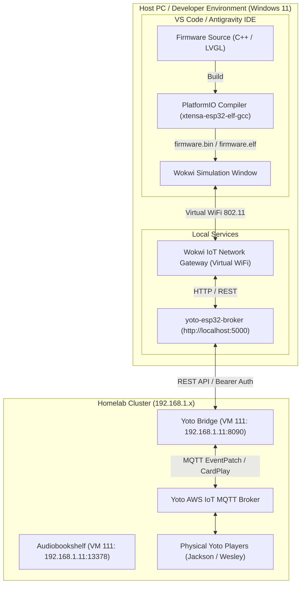

# Wokwi ESP32 Firmware Emulation & End-to-End Simulation Guide

> **Target Platform:** ESP32 / ESP32-S3 (Xtensa Dual-Core 240 MHz)  
> **Firmware Framework:** C++ / Arduino / PlatformIO / LVGL  
> **Simulation Engine:** [Wokwi Embedded Systems Simulator](https://wokwi.com) & Wokwi VS Code Extension  
> **Companion Middleware:** [`yoto-esp32-broker`](../README.md) (Python / FastAPI / SQLite)  
> **Bridge Target:** [`yoto-audiobookshelf-bridge`](https://github.com/alicia86/yoto-audiobookshelf-bridge) on VM 111  

---

## 1. Overview & Architectural Rationale

Developing and testing embedded firmware on physical microcontrollers traditionally suffers from significant friction:
- Repetitive USB flashing cycles (30–60 seconds per upload).
- Serial COM port contention, disconnects, and manual boot-loader button pressing (`BOOT` + `EN`).
- Inability to easily simulate peripheral edge cases (e.g. corrupted NFC tag reads, dropped Wi-Fi packets, rapid touch bouncing).
- Risk of bricking or locking up physical hardware boards during early memory-allocation and FreeRTOS task tuning.

By leveraging **Wokwi**, we establish a **100% virtual hardware bench** that runs the **exact same compiled Xtensa `.bin` / `.elf` binary** that is deployed to physical silicon.



---

## 2. Prerequisites & Installation

### 2.1 Software Requirements
1. **VS Code** (or Antigravity IDE).
2. **PlatformIO IDE Extension:**
   - **Microsoft VS Code Marketplace:** [`platformio.platformio-ide`](https://marketplace.visualstudio.com/items?itemName=platformio.platformio-ide)
   - **Open-VSX Registry (Antigravity IDE / VSCodium):** [`LordImmaculate.platformio-ide`](https://open-vsx.org/vscode/item?itemName=LordImmaculate.platformio-ide) or install the official VSIX directly from the [PlatformIO Releases](https://github.com/platformio/platformio-vscode-ide/releases).
   - Alternatively, install the core CLI globally via `pip install platformio`.
3. **Wokwi Simulator Extension:** ([`wokwi.wokwi-vscode`](https://marketplace.visualstudio.com/items?itemName=wokwi.wokwi-vscode)).
4. **Wokwi License / Club Token:**
   - Press `Ctrl + Shift + P` -> `Wokwi: Request License` (or `Wokwi: Sign In`).
   - Private Gateway support requires an active Wokwi Club / Pro subscription or trial license.

### 2.2 Wokwi Private IoT Gateway (Local Network & Homelab Access)
By default, Wokwi's public gateway allows outbound internet access, but cannot reach servers running on `localhost` or private RFC 1918 subnets (`192.168.1.0/24`). To allow the simulated ESP32 to communicate with your local `yoto-esp32-broker` (`localhost:5000`) and the homelab Yoto Bridge on VM 111 (`192.168.1.11:8090`), run the **Wokwi Private IoT Gateway**:

1. **Download Gateway:**
   - **GitHub Repository:** [`wokwi/wokwigw`](https://github.com/wokwi/wokwigw)
   - **Releases Page:** [https://github.com/wokwi/wokwigw/releases/](https://github.com/wokwi/wokwigw/releases/)
   - Download the latest binary (e.g. [**Wokwi IoT Gateway v2.0.1**](https://github.com/wokwi/wokwigw/releases/tag/v2.0.1)).
   - On Windows, download `wokwigw-windows-amd64.exe` (or `wokwigw-windows-arm64.exe` for ARM).
2. **Install Network Driver (Windows Only):**
   - The gateway uses a virtual TAP/tun network adapter. Download and install [**TAP-Windows**](https://openvpn.net/community-downloads/) (or run the gateway as administrator to let it prompt for driver configuration).
3. **Launch the Gateway:**
   - Open PowerShell as Administrator and run:
     ```powershell
     .\wokwigw-windows-amd64.exe
     ```
   - For detailed usage and options, refer to the official [Wokwi ESP32 WiFi & Private Gateway Guide](https://docs.wokwi.com/guides/esp32-wifi#the-private-gateway).
4. **Firmware Wi-Fi Credentials:**
   - In your ESP32 C++ firmware, connect to:
     - **SSID:** `"Wokwi-GUEST"`
     - **Password:** `""` (Empty string)
   - The gateway assigns the ESP32 an IP address on your private virtual subnet and routes requests transparently.

---

## 3. Project Configuration Files

The virtual bench requires three declarative configuration files in the firmware project root:

```
firmware/
├── platformio.ini       # Compiler settings, chip target, libraries
├── wokwi.toml           # Wokwi simulation harness & binary path
├── diagram.json         # Virtual hardware wiring & component list
└── src/
    └── main.cpp         # Firmware entry point
```

### 3.1 `platformio.ini`
Configures the PlatformIO toolchain to build an ESP32 binary with debug symbols enabled for source-level step debugging.

```ini
[env:esp32dev]
platform = espressif32
board = esp32dev
framework = arduino
monitor_speed = 115200
build_type = debug

# Enable FreeRTOS debug symbols and core dump inspection
build_flags = 
    -D CORE_DEBUG_LEVEL=3
    -D WOKWI_SIMULATION=1
    -D LV_CONF_INCLUDE_SIMPLE=1

lib_deps = 
    lvgl/lvgl@^8.3.11
    bodmer/TFT_eSPI@^2.5.43
    miguelbalboa/MFRC522@^1.4.11
    bblanchon/ArduinoJson@^7.0.4
```

### 3.2 `wokwi.toml`
Tells Wokwi where PlatformIO emits the compiled ELF and binary files and configures RFC2217 serial monitoring.

```toml
[wokwi]
version = 1
elf = ".pio/build/esp32dev/firmware.elf"
bin = ".pio/build/esp32dev/firmware.bin"

# Enable networking through Wokwi Gateway
[net]
enabled = true
```

### 3.3 `diagram.json` (Virtual Hardware Bench Wiring)
This JSON file defines the virtual hardware layout inside Wokwi:
- **MCU:** `board-esp32-devkit-c-v4`
- **Display:** `board-ili9341-touch` (320x240 color TFT + XPT2046 touch controller)
- **NFC Reader:** `wokwi-mfrc522` (RFID reader connected over VSPI)
- **Status LED:** Dual-color LED for broker connectivity status

```json
{
  "version": 1,
  "author": "Alicia",
  "editor": "wokwi",
  "parts": [
    { "type": "board-esp32-devkit-c-v4", "id": "esp", "top": 0, "left": 0, "attrs": {} },
    {
      "type": "board-ili9341-touch",
      "id": "lcd",
      "top": -80,
      "left": 220,
      "attrs": { "rotation": "90" }
    },
    {
      "type": "wokwi-mfrc522",
      "id": "rfid",
      "top": 160,
      "left": 220,
      "attrs": { "tagUid": "E2 80 11 05" }
    },
    {
      "type": "wokwi-led",
      "id": "led_green",
      "top": 280,
      "left": 100,
      "attrs": { "color": "green" }
    }
  ],
  "connections": [
    [ "esp:GND.1", "lcd:GND", "black", [ "v0" ] ],
    [ "esp:3V3", "lcd:VCC", "red", [ "v0" ] ],
    [ "esp:18", "lcd:SCK", "orange", [ "v0" ] ],
    [ "esp:23", "lcd:MOSI", "green", [ "v0" ] ],
    [ "esp:19", "lcd:MISO", "blue", [ "v0" ] ],
    [ "esp:15", "lcd:CS", "yellow", [ "v0" ] ],
    [ "esp:2", "lcd:DC", "purple", [ "v0" ] ],
    [ "esp:4", "lcd:RESET", "gray", [ "v0" ] ],

    [ "esp:18", "rfid:SCK", "orange", [ "h20", "v80" ] ],
    [ "esp:23", "rfid:MOSI", "green", [ "h30", "v80" ] ],
    [ "esp:19", "rfid:MISO", "blue", [ "h40", "v80" ] ],
    [ "esp:5", "rfid:SDA", "white", [ "v0" ] ],
    [ "esp:22", "rfid:RST", "cyan", [ "v0" ] ],
    [ "esp:GND.2", "rfid:GND", "black", [ "v0" ] ],
    [ "esp:3V3", "rfid:3V3", "red", [ "v0" ] ],

    [ "esp:13", "led_green:A", "green", [ "v0" ] ],
    [ "esp:GND.1", "led_green:C", "black", [ "v0" ] ]
  ]
}
```

---

## 4. End-to-End Firmware Integration Testing

### 4.1 Networking & IP Addressing in Simulation
When the simulated ESP32 boots in Wokwi with the Wokwi Gateway enabled:
- **SSID:** Connect to `"Wokwi-GUEST"`
- **Password:** `""` (Empty string)
- **Host PC Address:** The host computer running your `yoto-esp32-broker` is accessible from the simulator at:
  - `http://10.0.2.2:5000` (Standard NAT gateway address)
  - OR your local LAN IP: `http://192.168.1.x:5000`

### 4.2 End-to-End Test Workflow

```
[Virtual Wokwi Bench]             [Host PC: 5000]                 [VM 111: 8090]             [Yoto Cloud]
(Click RFID Tag)
       |
       |--- 1. Reads UID (E2 80 11 05) -->|
       |--- 2. POST /api/kids/tap -------->|
       |       { "nfc_uid": "E2801105" }  |--- 3. Lookup Book & Check Access -->|
       |                                  |--- 4. POST /api/play -------------->|
       |                                  |                                     |--- 5. MQTT CardPlay --> Yoto Player
       |<-- 6. Returns Book Metadata -----|
       |       { "title": "Boxcar #3",    |
       |         "cover_url": "..." }     |
       |
       |--- 7. GET /api/books/.../cover ->|
       |<-- 8. Returns 565 / JPEG stream -|
       |
  (Renders cover on virtual ILI9341 LCD)
  (Child taps "Pause" on virtual touchscreen)
       |
       |--- 9. POST /api/control --------->|
       |       { "action": "pause" }      |--- 10. POST /api/control ---------->|
       |                                  |                                     |--- 11. MQTT Pause ----> Yoto Player
```

### 4.3 Interactive Testing in Wokwi
1. **Swipe Virtual Card:** Click on the `wokwi-mfrc522` RFID reader in the simulation canvas. Wokwi triggers an antenna detection event with tag UID `E2 80 11 05`.
2. **Verify Serial Output:** Observe the PlatformIO / Wokwi terminal monitor:
   ```text
   [NFC] Tag Detected: E2 80 11 05
   [HTTP] Dispatched tap to http://10.0.2.2:5000/api/kids/tap
   [HTTP] Response 200 OK: Playing 'The Boxcar Children Collection, Volume 3'
   [TFT] Rendering cover image (320x240)...
   ```
3. **Simulate Touch Gestures:** Click and drag your mouse on the virtual LCD. The simulated XPT2046 touch controller converts your mouse coordinates into hardware SPI interrupts, driving the LVGL button tap animations.
4. **Inspect Broker Logs:** Check the terminal running `sample app/app.py` to confirm the broker received the request and relayed it to VM 111 without errors.

---

## 5. Transitioning from Wokwi Emulation to Physical Hardware

Because Wokwi executes pure binary code, transitioning from simulation to the physical **Waveshare ESP32-S3-Touch-LCD-4.3B** requires zero changes to your business logic, state machines, or broker communication protocols.

| Subsystem | Wokwi Simulation Bench | Physical Waveshare ESP32-S3 Board |
| :--- | :--- | :--- |
| **SoC** | ESP32 (Xtensa Dual-Core) | ESP32-S3 (Xtensa Dual-Core 240 MHz) |
| **Display Panel** | ILI9341 SPI (320x240) | 4.3" 800x480 Parallel RGB565 Panel |
| **Touch Controller** | XPT2046 (SPI) | Goodix GT911 (I2C) |
| **NFC Reader** | MFRC522 (SPI) | PN532 or MFRC522 (SPI/I2C) |
| **UI Engine** | LVGL v8 / v9 | LVGL v8 / v9 |
| **Network Protocol** | Wokwi-GUEST Virtual Wi-Fi | Local 2.4 GHz 802.11 b/g/n Wi-Fi |
| **Broker API Client** | `HTTPClient` (REST / JSON) | `HTTPClient` (REST / JSON) |

### Recommended Hardware Abstraction Strategy:
Use preprocessor directives (`#ifdef WOKWI_SIMULATION`) in your display initialization header:
```cpp
#ifdef WOKWI_SIMULATION
    #include "display_ili9341_spi.h"
#else
    #include "display_waveshare_rgb.h"
#endif
```
This enables you to run the simulator continuously during day-to-day feature development and only flash physical hardware for final verification.
