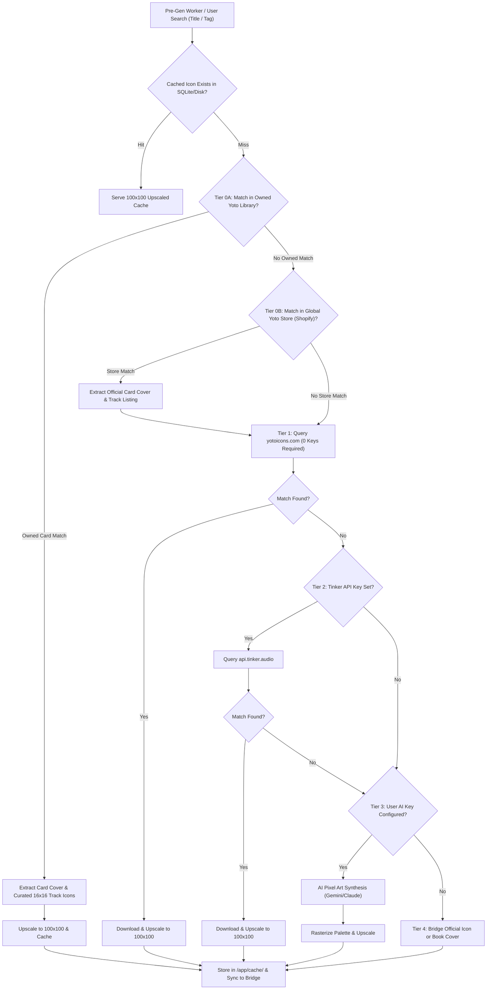
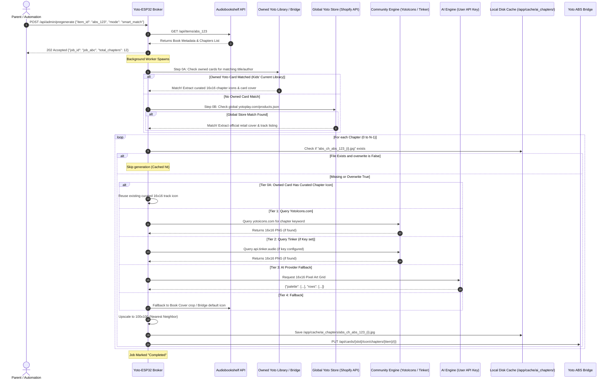

# Feature Specification: Broker Chapter Metadata, Multi-Tier Community Icons & AI Generation
**Document ID:** `001-broker_chapter_metadata_and_batch_pregen`  
**Status:** Approved  
**Component:** Middleware Broker Intelligence & Icon Engine  
**Target File:** `sample app/app.py`, `sample app/ai_service.py`, `sample app/icon_engine.py`  

---

## 1. Executive Summary & Purpose
When a child browses an audiobook or playlist on the bedside ESP32 touchscreen, the controller displays the chapter breakdown alongside child-friendly chapter artwork. To maintain instant, fluid touchscreen responsiveness on a microcontroller with constrained network throughput and limited internal RAM, chapter metadata must be lightweight, stripped of unused desktop fields, and chapter artwork must ideally be pre-cached.

This specification defines two critical broker-side capabilities:
1. **Lightweight Chapter Metadata Endpoint (`GET /api/items/<id>/chapters`):** Delivers clean, microcontroller-optimized arrays of chapters with titles, durations, start offsets, and thumbnail URLs.
2. **Multi-Tier Chapter Artwork & Community Icon Engine (`POST /api/admin/pregenerate` & `GET /api/admin/icons/search`):** A unified 6-tier resolution pipeline providing rich 16×16 pixel art icons, prioritizing matching existing physical cards and community assets before consuming AI tokens:
   * **Tier 0A (Household Owned Cards & Curated Track Icons):** Inspects the family's owned Yoto library (both official retail cards and existing MYO playlists). If an Audiobookshelf book matches an owned card, the broker extracts the card's authentic high-res cover art and **pre-curated 16×16 track display icons** (`display.iconUrl16x16` or bridge `/s/icon/...`) directly.
   * **Tier 0B (Global Yoto Storefront Catalog & Tracklists):** Queries the public Shopify catalog (`yotoplay.com/products.json`). Matches books against the entire worldwide commercial Yoto card library (even unowned cards), pulling official retail card covers and parsing product track listings to clean up chapter titles.
   * **Tier 1 (YotoIcons Community - Zero Keys Needed):** Real-time web search and asset fetching from `yotoicons.com` (`https://yotoicons.com/icons?tag={q}`) requiring zero authentication, accounts, or developer keys.
   * **Tier 2 (Tinker Icons - Curated Library):** Programmatic REST search via `api.tinker.audio` using an optional free developer key (`X-Tinker-Key`) provided by the user in Settings.
   * **Tier 3 (User AI Generation - Custom Synthesis Fallback):** When no existing card or community icon is matched (or when the parent explicitly requests custom generative scenes), the broker calls the user's configured AI provider (Gemini, Claude, OpenRouter) to synthesize bespoke 16×16 pixel art.
   * **Tier 4 (Bridge & Cover Fallback):** Safe default falling back to official Yoto bridge icons or center-cropped, downscaled book covers.

Pre-generated icons are upscaled to 100×100 via Nearest-Neighbor sampling for the ESP32 touchscreen, synced upstream to `yoto-audiobookshelf-bridge` (for physical player displays), and committed to the SQLite/disk cache. This guarantees zero render delay when the child views the chapter list on the physical device.

---

## 2. Technical Entity Mapping & API Contracts

### 2.1 Endpoint Specification Table

| Method | Route | Auth / Pin | Query / Body Params | Response Code | Output Format / Schema |
| :--- | :--- | :--- | :--- | :--- | :--- |
| `GET` | `/api/items/<id>/chapters` | None | None | `200 OK` | Microcontroller JSON array of chapter summaries. |
| `GET` | `/api/items/<id>/chapters` | None | Invalid `<id>` | `404 Not Found` | `{"ok": false, "error": "Item not found"}` |
| `GET` | `/api/admin/icons/search` | Admin Session | `?q=<term>&source=<auto\|tinker\|yotoicons\|ai>` | `200 OK` | Array of matching 16×16 icons with source attribution. |
| `POST` | `/api/admin/pregenerate` | Optional PIN | `{"item_id": "<id>", "mode": "community_first", "overwrite": false}` | `202 Accepted` | `{"ok": true, "job_id": "<uuid>", "status": "started"}` |
| `GET` | `/api/admin/pregenerate/<job_id>` | None | None | `200 OK` | `{"job_id": "<id>", "progress": 0.45, "status": "running"}` |

---

### 2.2 Microcontroller JSON Schema (`GET /api/items/<id>/chapters`)

#### Response Payload (`200 OK`):
```json
[
  {
    "index": 0,
    "title": "An Unexpected Party",
    "start": 0.0,
    "duration": 1845.2,
    "thumb": "/api/thumb?type=abs_chapter&id=c1f7a4e8-8b9a-4c2d-9b1e-3a4f5c6d7e8f&chapter=0&size=100"
  },
  {
    "index": 1,
    "title": "Roast Mutton",
    "start": 1845.2,
    "duration": 2104.0,
    "thumb": "/api/thumb?type=abs_chapter&id=c1f7a4e8-8b9a-4c2d-9b1e-3a4f5c6d7e8f&chapter=1&size=100"
  }
]
```

#### Field Definition Table:
| JSON Field | Type | Description | Optimization Constraint |
| :--- | :--- | :--- | :--- |
| `index` | `integer` | 0-indexed position matching ABS track/chapter index. | Used directly in ArduinoJson loops. |
| `title` | `string` | Chapter title. | Automatically truncated to 40 characters maximum to prevent ArduinoJson buffer overruns. |
| `start` | `float` | Start offset from book beginning in seconds. | Rounded to 1 decimal place. |
| `duration` | `float` | Length of chapter in seconds. | Rounded to 1 decimal place. |
| `thumb` | `string` | Local broker URL to fetch 100×100 JPEG thumbnail. | Relative path; points to on-demand resizer and cache. |

---

## 3. Architecture & Multi-Tier Resolution Flow





---

## 4. Implementation Details & Edge Cases

### 4.1 Narrative Text Heuristic for Generic Titles
Many audiobooks ripped from CDs or basic files contain uninformative chapter titles such as `"Chapter 1"`, `"Track 05"`, or `"Part 2"`.
* **Detection Rule:** Evaluated against regex: `r"^(chapter|track|part|section|disc|cd|ch\.?|trk\.?)\s*\d+(\s*[-:]\s*\d+)?$"`
* **Enrichment Action:** When detected, the background generator pulls the book's long synopsis or chapter description from Audiobookshelf, extracting the first 250 characters of narrative text to feed into the prompt context.

### 4.2 Multi-Tier Provider Integrations & Matching Heuristics

#### 4.2.0 Tier 0A: Household Owned Cards & Curated Track Icons
Before querying external sources or invoking generative AI, the broker inspects the local family's owned Yoto library (both official retail cards and existing Make-Your-Own playlists):
1. **Title & Author Fuzzy Matching:** Compares the Audiobookshelf book title and author against cards in `yoto_client.get_raw_library()`. If string similarity exceeds `0.85` (using Levenshtein / token sort ratio), the book is flagged as an owned library match.
2. **Pre-Curated Track & Chapter Icons:**
   * When kids are already playing a card, it often has pre-linked icons curated for its chapters (`display.iconUrl16x16` or bridge `/s/icon/{slot}/{layout}/{k}.png`).
   * The broker pulls these curated chapter icons directly into `./cache/ai_chapters/`, mapping them 1:1 to the corresponding Audiobookshelf chapters using track duration alignment (`tol(d) = 2.5 + 0.002 * d`).
   * **Result:** Reuses authentic curated artwork with zero external API calls.

#### 4.2.1 Tier 0B: Global Yoto Storefront Catalog & Tracklists (`products.json`)
For audiobooks that are not currently in the family's physical Yoto library, the broker leverages Yoto's public Shopify e-commerce catalog:
1. **Public Store Endpoint:** `https://yotoplay.com/products.json?limit=250` (and `us.yotoplay.com/products.json`).
2. **Offline Catalog Cache:** The broker maintains a lightweight SQLite index of published commercial Yoto cards (updated weekly).
3. **Data Extracted (Zero Authentication):**
   * **High-Res Official Card Cover:** Pulled from `product.images[0].src`, eliminating the need to search Google Images or rely on generic book covers.
   * **Track Listings:** Scrapes the `<ul class="track-list">` from the product description HTML to auto-populate clean, human-readable chapter titles for messy audio files (e.g. replacing `"Track 01"` with `"An Unexpected Party"`).
   * **Chapter Icon Search Term:** The extracted track title is then fed into Tier 1 (`yotoicons.com`) or Tier 2 (`tinker.audio`) to find matching pixel art.

#### 4.2.1 Tier 1: YotoIcons Community (`yotoicons.com` - Zero Keys Needed)
* **Endpoint:** `GET https://yotoicons.com/icons?tag={query}&order=popular`
* **Scraping Rule:** Lightweight HTML parse using regex/BeautifulSoup extracting `<div class="icon" onclick="populate_icon_modal(...)">` to retrieve `id`, `category`, and title.
* **Direct Asset Stream:** Downloads `https://yotoicons.com/static/uploads/{id}.png` and converts it to a standard 16×16 RGBA buffer.
* **Credentials:** 100% zero-configuration (no developer keys or login required).

#### 4.2.2 Tier 2: Tinker Icons (`api.tinker.audio` - Free Developer Key)
* **Endpoint:** `GET https://api.tinker.audio/icons?q={words}&limit={n}&base64=true`
* **Authentication Header:** `X-Tinker-Key: <key>`
* **Attribution Requirement:** As stipulated by Tinker developer guidelines, whenever Tinker icons are rendered in the Admin Portal, the UI displays the *"Powered by Tinker"* badge linking to `https://developers.tinker.audio`.
* **Rate Limits:** 30 req/min, 150 req/hr, 500 req/day. Handled with automatic `429` backoff reading the `Retry-After` header.

#### 4.2.3 Tier 3: AI Provider Fallback (User Key)
* **Trigger:** Invoked only when (a) no existing Yoto card or community icon matches or (b) the parent explicitly selects "Generate Custom AI Icon" in the UI.
* **Supported Backends:** Gemini 1.5/2.0 Flash (`google-genai`), Anthropic Claude 3.5 Haiku/Sonnet (`anthropic`), or OpenRouter (`openai` client compatible).
* **Cost Efficiency:** Prioritizing existing cards and community icons first cuts user AI token costs by ~90% across large audiobook libraries.

### 4.3 Rate Limiting & Concurrency Safety
* Background worker runs as a detached Python `threading.Thread`.
* Inter-request delay is enforced at `1.5 seconds` minimum to prevent hitting Gemini/Anthropic/OpenRouter tier-1 rate limits (RPM limits).
* A process-level lock (`threading.Lock()`) prevents multiple concurrent pre-generation runs on the same book item.

---

## 5. Verification & Acceptance Criteria
1. `GET /api/items/<valid_id>/chapters` returns `200 OK` with valid JSON containing all chapters.
2. Character count of each title is $\le 40$ characters.
3. `GET /api/admin/icons/search?q=cat` returns aggregated results from YotoIcons and Tinker (if key set).
4. Triggering `POST /api/admin/pregenerate` processes all chapters sequentially without blocking HTTP request handling.
5. If no community icon is matched, the engine seamlessly invokes the user's configured AI provider.
6. Generated 100×100 JPEGs appear in `./cache/ai_chapters/` and can be fetched via `/api/thumb?type=abs_chapter&id=<id>&chapter=0`.
