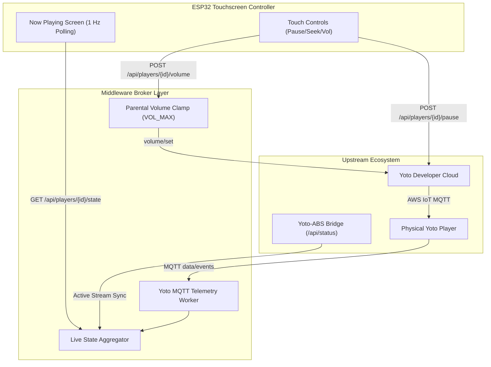

# Feature Specification: Live Telemetry & Now Playing Control API
**Document ID:** `002-live_telemetry_and_now_playing_api`  
**Status:** Approved  
**Component:** Telemetry & Playback Control Layer  
**Target File:** `sample app/app.py`  

---

## 1. Executive Summary & Purpose
When a child taps play on an audiobook or Yoto card, the bedside touchscreen controller transitions to a dedicated **Now Playing Screen**. To display active chapter titles, elapsed/remaining track time, dynamic progress bars, and real-time play/pause status, the controller requires a unified status polling endpoint that abstracts the underlying complexities of the Yoto Developer MQTT broker and Audiobookshelf streaming sessions.

Additionally, the bedside controller serves as a physical bedside remote. Parents or children can pause, resume, skip tracks, and adjust volume directly from the touchscreen. This document defines the bidirectional telemetry aggregation engine, the live snapshot endpoint (`GET /api/players/<player_id>/state`), and the safe remote control endpoints with parental volume caps.

---

## 2. Technical Entity Mapping & API Contracts

### 2.1 Endpoint Specification Table

| Method | Route | Parameter | Description | Success Response |
| :--- | :--- | :--- | :--- | :--- |
| `GET` | `/api/players/<id>/state` | `<id>`: Yoto Device ID | Aggregated live playback & device status snapshot. | `200 OK` (JSON schema below) |
| `POST` | `/api/players/<id>/pause` | `<id>`: Yoto Device ID | Pauses playback on target player. | `200 OK` `{"ok": true, "status": "paused"}` |
| `POST` | `/api/players/<id>/resume` | `<id>`: Yoto Device ID | Resumes playback on target player. | `200 OK` `{"ok": true, "status": "playing"}` |
| `POST` | `/api/players/<id>/seek` | `{"seconds": 120.0}` | Jumps to target playback position. | `200 OK` `{"ok": true, "position": 120.0}` |
| `POST` | `/api/players/<id>/volume` | `{"volume": 45}` | Sets volume (0-100), clamped to `VOL_MAX`. | `200 OK` `{"ok": true, "volume": 45}` |

---

### 2.2 Live Snapshot JSON Schema (`GET /api/players/<id>/state`)

```json
{
  "device_id": "y2_sample_player_id_1",
  "online": true,
  "status": "playing",
  "media_type": "abs",
  "media_id": "c1f7a4e8-8b9a-4c2d-9b1e-3a4f5c6d7e8f",
  "title": "The Hobbit",
  "author": "J.R.R. Tolkien",
  "chapter_index": 2,
  "chapter_title": "A Short Rest",
  "position": 342.5,
  "duration": 1820.0,
  "progress_percent": 18.8,
  "volume": 40,
  "volume_clamped": false,
  "battery": 88,
  "charging": true,
  "age_seconds": 0.4
}
```

#### Field Technical Breakdown:
| Field | Type | Description / Upstream Mapping |
| :--- | :--- | :--- |
| `status` | `string` | Current state: `"playing"`, `"paused"`, `"stopped"`, or `"idle"`. |
| `media_type` | `string` | `"abs"` (Audiobookshelf stream) or `"yoto"` (Native cloud card). |
| `position` | `float` | Current playback position in seconds (derived from MQTT `position` or ABS stream ticks). |
| `duration` | `float` | Total track duration in seconds. |
| `volume` | `integer` | Current hardware volume percentage (0 to 100). |
| `battery` | `integer` | Battery state of charge percentage (0 to 100). |
| `age_seconds` | `float` | Latency since the last upstream telemetry packet was received. |

---

## 3. Architecture & Data Flow



---

## 4. Hardware Safety & Volume Protection (Parental Guardrail)
* **Hearing Protection Standard:** A hard ceiling `VOL_MAX` (default: 60%) is enforced in the broker's configuration (`config.json` and `.env`).
* **Enforcement Gate:** Any command submitted to `/api/players/<id>/volume` requesting a level exceeding `VOL_MAX` is silently clamped down to `VOL_MAX`:
  ```python
  requested_vol = int(payload.get("volume", 30))
  safe_vol = max(0, min(VOL_MAX, requested_vol))
  ```
* This prevents younger siblings or accidental screen taps from blasting high volume in a quiet bedroom.

---

## 5. Verification & Acceptance Criteria
1. Polling `/api/players/<id>/state` returns `200 OK` with valid telemetry when a player is active.
2. Volume commands above `VOL_MAX` return clamped values.
3. Rapid pause/resume commands are properly forwarded to Yoto Cloud without dropping connections.
