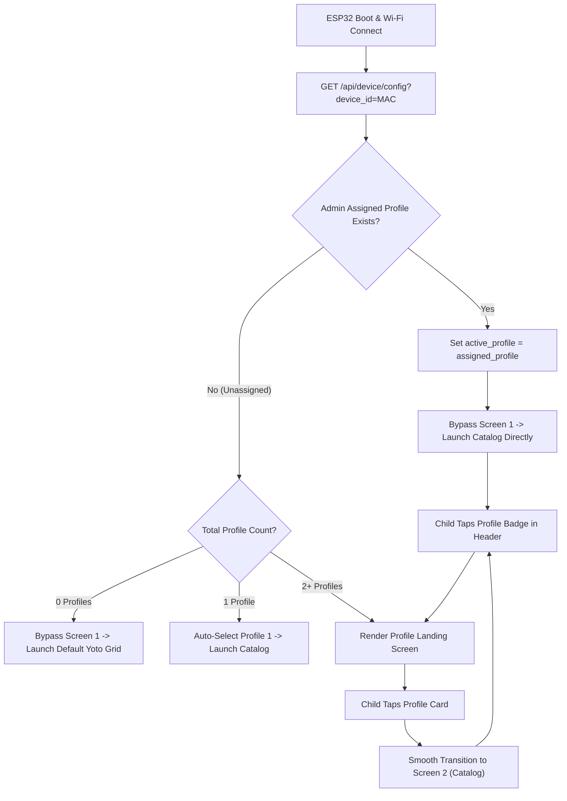

# Feature Specification: ESP32 Firmware Profile Selection (Screen 1)
**Document ID:** `003-esp32_firmware_profile_selection`  
**Status:** Approved  
**Component:** ESP32 Firmware UI & NVS State  
**Target Hardware:** Waveshare ESP32-S3-Touch-LCD-4.3B (800×480)  

---

## 1. Executive Summary & Purpose
In multi-child households, multiple children may have their own dedicated bedside controllers (e.g. "Oliver's Bedroom Controller", "Maya's Bedside Controller"), or they may share a single controller in a playroom.

This specification enhances **Screen 1 & Profile Resolution** with two configurable modes:
1. **Device-Assigned Default Profile:** Through the Admin Web Portal, an administrator can assign a specific child profile directly to a registered ESP32 device (identified by MAC address or Device ID). When powered on, the device automatically defaults to that child's profile and opens directly into their personalized catalog.
2. **Interactive Landing Screen (Shared Device):** If no profile is pre-assigned to the device in the admin portal, the device displays the visual landing screen on boot, prompting the child to tap their avatar.
3. **Always-Available Alternate Profile Switcher:** Regardless of whether a device has a pre-assigned default profile, whenever more than one profile exists in the household, the controller displays a profile switcher badge/pill in the top navigation bar. Tapping it at any time opens the profile selection screen to easily switch to an alternate sibling's catalog.

---

## 2. Technical Entity Mapping & Memory Model

### 2.1 Non-Volatile Storage (NVS) Schema

| NVS Namespace | Key | Type | Default | Description |
| :--- | :--- | :--- | :--- | :--- |
| `yoto_cfg` | `device_id` | String (max 32 chars) | MAC Address | Unique hardware ID sent to broker for device-level config. |
| `yoto_cfg` | `active_profile` | String (max 32 chars) | `""` | Currently active child profile ID (e.g. `"child_one"`). |
| `yoto_cfg` | `profile_name` | String (max 32 chars) | `""` | Display name (e.g. `"Child One"`). |
| `yoto_cfg` | `default_player` | String (max 32 chars) | `""` | Default physical Yoto Player Device ID. |

---

### 2.2 Broker Endpoint Dependency & Device Handshake

* **Device Config & Profile Discovery Route:** `GET http://<broker_ip>:5055/api/device/config?device_id=<mac_address>`
* **Response Payload (`200 OK`):**
  ```json
  {
    "device_id": "esp32_c44f331122aa",
    "assigned_profile": "child_one",
    "allow_profile_switch": true,
    "profiles": [
      {
        "id": "child_one",
        "display_name": "Oliver",
        "avatar_url": "/api/thumb?type=profile&id=child_one"
      },
      {
        "id": "child_two",
        "display_name": "Maya",
        "avatar_url": "/api/thumb?type=profile&id=child_two"
      }
    ]
  }
  ```

---

## 3. UI Blueprint & Interaction Schemas

### 3.1 Display Layout (800×480 Landscape)

```text
+-----------------------------------------------------------------------------+
|                                                                             |
|                           WHO IS LISTENING TONIGHT?                         |
|                    [ Subtitle: Tap your name to start ]                     |
|                                                                             |
|            +-----------------------+     +-----------------------+          |
|            |      [ AVATAR ]       |     |      [ AVATAR ]       |          |
|            |                       |     |                       |          |
|            |       CHILD ONE       |     |       CHILD TWO       |          |
|            |   (Bedroom Player 1)  |     |   (Bedroom Player 2)  |          |
|            +-----------------------+     +-----------------------+          |
|                                                                             |
| [⚙ Settings]                                                  [🕒 8:15 PM]  |
+-----------------------------------------------------------------------------+
```

### 3.2 LVGL Component Specification
* **Screen Container:** `lv_obj_create(NULL)`, background color `#121212` (dark theme).
* **Title Label:** `lv_label_create(screen)`, font `lv_font_montserrat_28`, color `#FFFFFF`, centered at `Y = 40`.
* **Profile Card Buttons:**
  * Width: `240px`, Height: `280px`, radius `16px`.
  * Style: `#1E1E1E` background, `2px` subtle border `#333333`.
  * Touch Feedback: On `LV_EVENT_PRESSED`, border highlights to `#E53935` (Yoto red accent) and scales slightly.
* **Persistent Header Badge:** On subsequent screens (Catalog, Details, Now Playing), a `32x32px` avatar pill appears at the top left/right. If `profiles.length > 1`, tapping this pill re-triggers Screen 1, allowing instantaneous switching to an alternate profile.

---

## 4. Architectural Rules & Execution Gates



---

## 5. Verification & Acceptance Criteria
1. When broker returns 2+ profiles, the landing screen renders cleanly without font distortion.
2. Tapping a profile immediately writes the profile key to NVS.
3. Power-cycling the board remembers the selected profile if configured, or prompts correctly.
4. If broker is unreachable, firmware defaults to local NVS cache without freezing or panicking.
