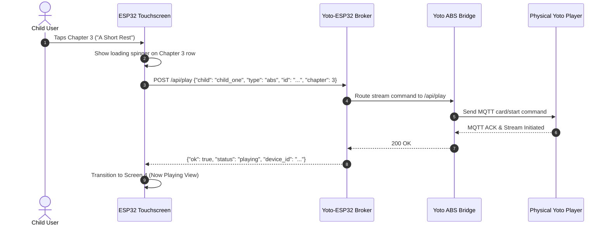

# Feature Specification: ESP32 Firmware Chapter Browser & Detail View (Screen 3)
**Document ID:** `005-esp32_firmware_chapter_browser_and_detail_view`  
**Status:** Approved  
**Component:** ESP32 Firmware UI & Playback Dispatcher  
**Target Hardware:** Waveshare ESP32-S3-Touch-LCD-4.3B (800×480)  

---

## 1. Executive Summary & Purpose
When a child taps on a book or card tile on the Catalog Screen (Screen 2), the controller navigates to **Screen 3: Chapter Browser & Detail View**. This screen serves two essential functions:
1. **Overview & Immediate Start:** Displays high-resolution cover artwork, full title, author, total running time, and a large, inviting "▶ Play on Bedroom Yoto" button to immediately resume or start the book.
2. **Track / Chapter Selection with AI Pixel Art:** A scrollable list of individual chapters, each adorned with its unique 16×16 retro pixel art icon (upscaled to 48×48 or 100×100), duration badge, and title. Tapping any specific chapter dispatches an immediate playback command to the physical Yoto player starting precisely at that chapter.

---

## 2. Technical Entity Mapping & API Contracts

### 2.1 Broker Endpoints Consumed
* **Chapter Breakdown:** `GET /api/items/<book_id>/chapters`
* **Chapter Pixel Art Thumbnail:** `GET /api/thumb?type=abs_chapter&id=<book_id>&chapter=<idx>&size=100`
* **Playback Dispatch:** `POST /api/play`
  * Payload:
    ```json
    {
      "child": "child_one",
      "type": "abs",
      "id": "c1f7a4e8-8b9a-4c2d-9b1e-3a4f5c6d7e8f",
      "chapter": 3
    }
    ```

---

## 3. UI Blueprint & Component Layout

### 3.1 Display Layout (800×480 Landscape)

```text
+-----------------------------------------------------------------------------+
|  [ < Back ]               BOOK DETAILS & CHAPTERS              [ 🕒 8:17 PM] |
+-----------------------------------------------------------------------------+
|  LEFT PANEL (320px)             | RIGHT PANEL (480px Scrollable Chapters)   |
|                                 |                                           |
|   +-----------------------+     |  +-------------------------------------+  |
|   |                       |     |  | [16x16] Ch 1: An Unexpected Party  |  |
|   |     LARGE COVER       |     |  |         Duration: 30:45             |  |
|   |       180x180         |     |  +-------------------------------------+  |
|   +-----------------------+     |  +-------------------------------------+  |
|   THE HOBBIT                    |  | [16x16] Ch 2: Roast Mutton          |  |
|   By J.R.R. Tolkien             |  |         Duration: 35:10             |  |
|                                 |  +-------------------------------------+  |
|   +-----------------------+     |  +-------------------------------------+  |
|   |  ▶ PLAY FROM START    |     |  | [16x16] Ch 3: A Short Rest          |  |
|   +-----------------------+     |  |         Duration: 22:15             |  |
|                                 |  +-------------------------------------+  |
+-----------------------------------------------------------------------------+
```

### 3.2 Component Details
* **Left Metadata Panel:**
  * Fixed width: `320px`, full height.
  * Cover image: `180×180px`, centered.
  * Title: `lv_font_montserrat_18`, bold, wrapped.
  * Play Button: Large green button `#2E7D32` with white play icon and text: `▶ Play on Yoto`.
* **Right Chapter Scroll List:**
  * Width: `480px`, vertical scroll container with scroll momentum.
  * Chapter Rows: Height `64px`, background `#222222`, rounded `8px`, margin `4px`.
  * Chapter Icon: `48×48px` rendered canvas showing the nearest-neighbor upscaled 16×16 AI pixel art.
  * Active Tap Feedback: Turns yellow/orange `#FF9800` on press before transitioning to Screen 4 (Now Playing).

---

## 4. Execution Sequence & Error Handling



### Edge Case Handling:
* **Offline Player:** If the physical Yoto player is offline or turned off, broker returns `502 Bad Gateway`. ESP32 displays a friendly, non-technical popup: *"Is your Yoto turned on and connected to Wi-Fi?"* with an OK button.
* **Single-Track Books:** If an audiobook has only 1 chapter, the right list displays a single track item, and tapping the main Play button directly begins playback.

---

## 5. Verification & Acceptance Criteria
1. Tapping any chapter initiates playback on the child's configured physical Yoto within 2 seconds.
2. 16×16 pixel art icons render with crisp retro edges (no blurry scaling).
3. Back button returns to Screen 2 with exact previous scroll position preserved.
