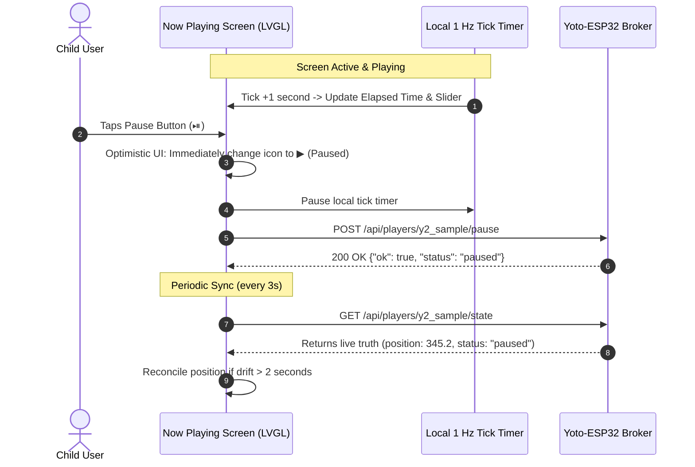

# Feature Specification: ESP32 Firmware Now Playing Screen (Screen 4)
**Document ID:** `006-esp32_firmware_now_playing_screen`  
**Status:** Approved  
**Component:** ESP32 Firmware UI & Remote Control  
**Target Hardware:** Waveshare ESP32-S3-Touch-LCD-4.3B (800×480)  

---

## 1. Executive Summary & Purpose
Once playback is initiated, the controller transitions to **Screen 4: Now Playing View**. This screen acts as a dedicated bedside audio console, providing real-time visual feedback of active playback progress and comprehensive remote control over the physical Yoto player.

Key capabilities include:
1. **Dynamic Progress Tracking:** Optimistic 1 Hz local tick counter synchronized periodically with telemetry from `GET /api/players/<id>/state`.
2. **Full Transport Controls:** Large, touch-friendly Prev Chapter (`⏮`), Play/Pause toggle (`⏯`), and Next Chapter (`⏭`) buttons.
3. **Parentally Capped Volume Slider:** Interactive touch slider capped at `VOL_MAX` (e.g. 60%) to safeguard young ears.
4. **Non-Disruptive Background Navigation:** A minimize chevron (`⌄`) allows children to return to the catalog while audio continues playing in the background.

---

## 2. Technical Entity Mapping & API Contracts

### 2.1 Polling & Control Endpoints
* **State Polling (every 3 seconds):** `GET /api/players/<player_id>/state`
* **Transport Commands:**
  * `POST /api/players/<player_id>/pause`
  * `POST /api/players/<player_id>/resume`
  * `POST /api/players/<player_id>/seek`
  * `POST /api/players/<player_id>/volume`

---

## 3. UI Blueprint & Component Layout

### 3.1 Display Layout (800×480 Landscape)

```text
+-----------------------------------------------------------------------------+
|  [ ⌄ Minimize ]               NOW PLAYING                     [ 🕒 8:18 PM] |
+-----------------------------------------------------------------------------+
|                                                                             |
|   +-----------------------+     THE HOBBIT                                  |
|   |                       |     Chapter 3: A Short Rest                     |
|   |      COVER ART        |     J.R.R. Tolkien                              |
|   |       200x200         |                                                 |
|   |                       |     [05:42] =====================o==== [22:15]  |
|   +-----------------------+                                                 |
|                                       [ ⏮ ]     [ ⏯ ]     [ ⏭ ]             |
|                                                                             |
|                                 Volume: [ 🔈 ] =======o=========== [ 🔊 ]    |
|                                                                             |
+-----------------------------------------------------------------------------+
```

### 3.2 Component Details
* **Background Styling:** Dark red-to-black linear gradient matching Yoto's signature bedtime aesthetic (`#8A1515` to `#121212`).
* **Cover Art Frame:** `200×200px`, `X=40, Y=80`, rounded corners `12px`, with subtle drop shadow.
* **Progress Bar:** `lv_slider`, width `480px`, height `12px`, bar color `#FFFFFF`, indicator color `#E53935`.
  * Left time label: Elapsed time (`MM:SS`).
  * Right time label: Total chapter duration (`MM:SS`).
* **Transport Buttons:**
  * `⏮` Previous: `64×64px`, triggers chapter decrement or restarts chapter.
  * `⏯` Play/Pause: Large centered `80×80px` button, toggles icon state immediately.
  * `⏭` Next: `64×64px`, triggers chapter increment.
* **Volume Slider:** `lv_slider`, width `360px`, height `8px`. Clamped in firmware UI to `VOL_MAX` (slider visual stop prevents dragging past safe limit).

---

## 4. State Synchronization & Optimistic UI Logic

To provide immediate, lag-free responsiveness on physical button taps:



---

## 5. Verification & Acceptance Criteria
1. Progress bar advances smoothly 1 second at a time while playing.
2. Tapping Play/Pause updates the UI icon instantly without waiting for network response.
3. Volume slider cannot be dragged past `VOL_MAX` (e.g. 60%).
4. Minimizing returns to Screen 2; tapping the floating bottom mini-player returns back to Screen 4.
