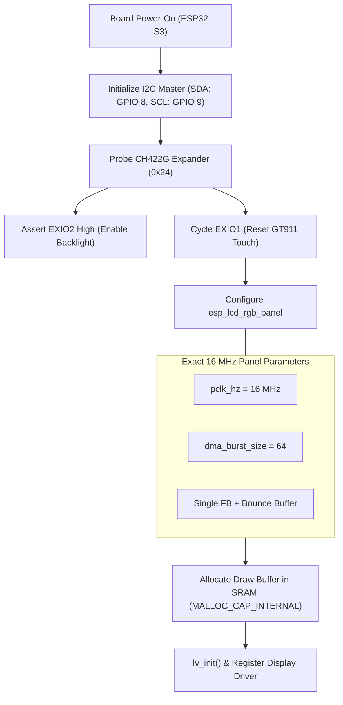
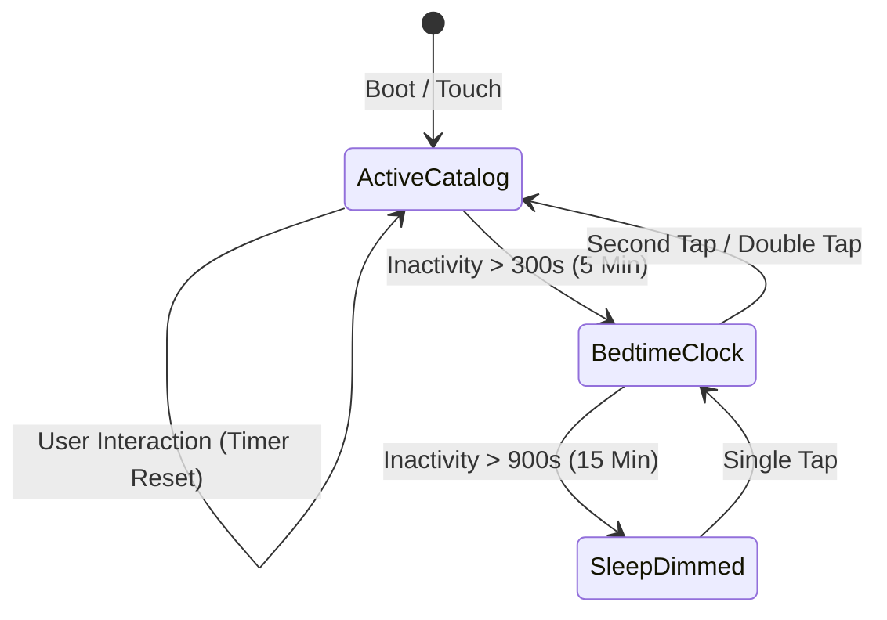

# Feature Specification: ESP32 Hardware Display & Power Management
**Document ID:** `007-esp32_hardware_display_and_power_management`  
**Status:** Approved  
**Component:** Embedded Hardware Drivers & Display Timing  
**Target Hardware:** Waveshare ESP32-S3-Touch-LCD-4.3B (Rev 1.1)  

---

## 1. Executive Summary & Purpose
The reference appliance hardware is the **Waveshare ESP32-S3-Touch-LCD-4.3B** (Rev 1.1), featuring an 800×480 RGB565 parallel interface display, Goodix GT911 capacitive touch screen, CH422G I²C expander, 16 MB QIO Flash, and 8 MB OPI PSRAM. 

This board exhibits several well-documented hardware pitfalls:
1. **RGB Pixel Clock Sensitivity:** The display panel fails to lock and outputs a solid white screen if clocked at standard 12 MHz or 14 MHz. It requires an exact **16 MHz pixel clock**.
2. **PSRAM Bandwidth & Scanline Underruns:** Direct double-buffered rendering in PSRAM causes DMA FIFO starvation, manifesting as white static lines on the left edge during network I/O.
3. **Bedside Light Disturbance:** In a child's bedroom, a bright LCD screen disrupts sleep.

This specification documents the exact register configurations, DMA burst flags, memory allocations, and the auto-dimming **Night Clock Screensaver** to guarantee rock-solid hardware stability and peaceful bedtime operation.

---

## 2. Hard-Won Hardware Configuration Table

| Subsystem | Parameter / Register | Required Setting | Engineering Rationale / Failure Mode Avoided |
| :--- | :--- | :--- | :--- |
| **RGB Pixel Clock** | `pclk_hz` | `16 * 1000 * 1000` (16 MHz) | Panel desyncs and produces white screen at 12 MHz. |
| **PCLK Polarity** | `pclk_active_neg` | `1` (Active Low) | Prevents clock jitter artifacts. |
| **DMA Burst Size** | `dma_burst_size` | `64` | Eliminates DMA FIFO underruns and left-edge static flicker. |
| **Cache Invalidation** | `bb_invalidate_cache` | `1` | Forces clean cache invalidation on PSRAM bounce buffer. |
| **Framebuffer Mode** | `num_fbs` | `1` (Single PSRAM Framebuffer) | Double-framebuffer in PSRAM saturates bus during Wi-Fi transfers. |
| **Draw Buffer Loc** | `MALLOC_CAP_INTERNAL` | Fast Internal SRAM | 2× faster rendering than PSRAM draw buffers. |
| **Backlight Control** | CH422G (I²C `0x24`) | EXIO2 Assert High | Backlight power is routed through I²C I/O expander, not native GPIO. |

---

## 3. Display Driver Initialization Architecture

---

## 4. Bedtime Night-Light & Screensaver Engine

To preserve healthy sleep hygiene in a child's bedroom:

### 4.1 State Transition Logic

### 4.2 Screensaver UI Specifications
* **Clock Layout:** Fullscreen dark background `#000000`.
* **Digit Color:** Deep warm amber `#D84315` or night-vision red `#C62828` (zero blue spectrum light).
* **Font:** Large 7-segment or clean sans-serif `lv_font_montserrat_48`.
* **Brightness Stepping:** PWM backlight stepped down smoothly from daytime `100%` down to `15%` during clock mode, and `5%` during sleep mode.

---

## 5. Verification & Acceptance Criteria
1. Display boots reliably 100 out of 100 power cycles with zero white-screen lockups.
2. Left edge of display is 100% free of static lines or flickering during active Wi-Fi downloads.
3. Inactivity timer triggers amber clock screensaver precisely at 5 minutes.
4. Single tap wakes display without lag or false touch triggers.
