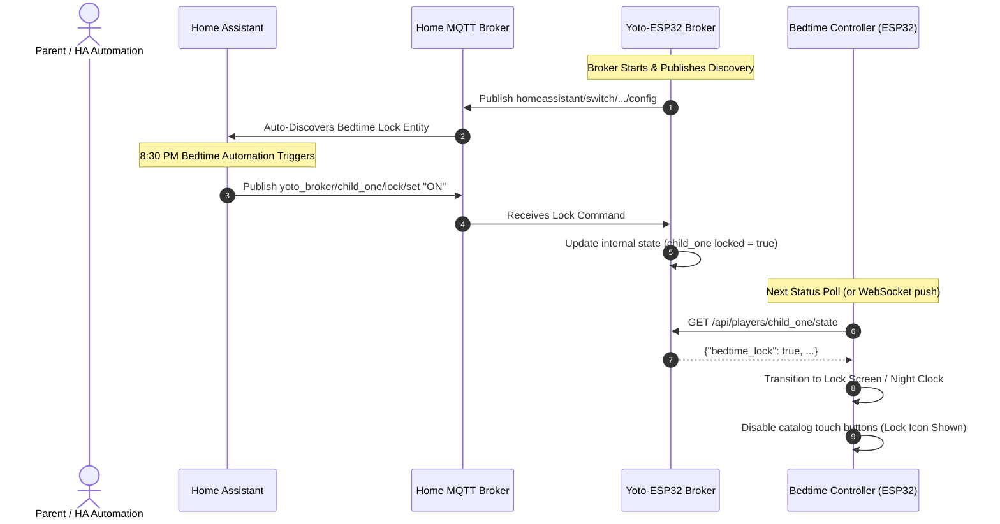

# Feature Specification: Home Assistant MQTT Discovery & Bedtime Lock
**Document ID:** `008-home_assistant_mqtt_discovery_and_bedtime_lock`  
**Status:** Approved  
**Component:** Homelab Ecosystem & Home Assistant Integration  
**Target File:** `sample app/app.py` & Broker MQTT Worker  

---

## 1. Executive Summary & Purpose
For home automation enthusiasts running Home Assistant, the bedside Yoto controller shouldn't be an isolated island. Parents need the ability to monitor what their children are listening to from their main dashboard and enforce bedtime routines automatically.

This specification details the **Home Assistant MQTT Auto-Discovery Engine**:
1. **MQTT Discovery:** Automatically registers the ESP32 controller and connected Yoto players in Home Assistant without manual YAML configuration.
2. **Bedtime Lock Entity (`switch.<child>_bedtime_lock`):** When turned ON (manually or via a 8:30 PM bedtime automation), forces the bedside ESP32 screen into clock mode, locking touch navigation so children cannot stay up late browsing cards.
3. **Backlight Control (`light.<controller>_backlight`):** Allows Home Assistant automations to dim or turn off the screen when room lights turn off.
4. **Active Playback Sensor (`sensor.<child>_yoto_active_book`):** Reports title, author, chapter, and battery level directly into Lovelace dashboards.

---

## 2. Technical Entity Mapping & MQTT Topics

### 2.1 Auto-Discovery Registry Table

| Entity Type | Entity ID | MQTT State Topic | MQTT Command Topic | Description |
| :--- | :--- | :--- | :--- | :--- |
| `switch` | `switch.<child>_bedtime_lock` | `homeassistant/switch/yoto_<child>_lock/state` | `homeassistant/switch/yoto_<child>_lock/set` | Locks screen into clock mode. |
| `light` | `light.<controller>_backlight` | `homeassistant/light/yoto_<child>_screen/state` | `homeassistant/light/yoto_<child>_screen/set` | Backlight brightness control (0-255). |
| `sensor` | `sensor.<child>_yoto_status` | `homeassistant/sensor/yoto_<child>_status/state` | None (Read-Only) | Status: `"playing"`, `"paused"`, `"idle"`. |
| `sensor` | `sensor.<child>_yoto_book` | `homeassistant/sensor/yoto_<child>_book/state` | None (Read-Only) | Active book title and chapter. |
| `sensor` | `sensor.<child>_yoto_battery` | `homeassistant/sensor/yoto_<child>_battery/state` | None (Read-Only) | Battery percentage + charging state. |

---

### 2.2 MQTT Discovery Payload Schema Example

#### Topic: `homeassistant/switch/yoto_child_one_lock/config`
```json
{
  "name": "Child One Bedtime Screen Lock",
  "unique_id": "yoto_child_one_bedtime_lock",
  "state_topic": "yoto_broker/child_one/lock/state",
  "command_topic": "yoto_broker/child_one/lock/set",
  "payload_on": "ON",
  "payload_off": "OFF",
  "icon": "mdi:lock-clock",
  "device": {
    "identifiers": ["yoto_esp32_controller_child_one"],
    "name": "Child One Yoto Bedside Controller",
    "model": "Waveshare ESP32-S3-Touch-LCD-4.3B",
    "manufacturer": "Homelab Community"
  }
}
```

---

## 3. Architecture & Interaction Flow



---

## 4. Bedtime Lock User Experience on Hardware
* **Visual Lock State:** When the child touches the screen while Bedtime Lock is active, the display shows a gentle amber message: *"Bedtime Lock Active — Sleep Well! 🌙"* for 3 seconds before fading back to the low-brightness amber clock.
* **Emergency Bypass:** A secret 4-tap gesture in the top-right corner allows parents to temporarily unlock the screen for 2 minutes without opening Home Assistant.

---

## 5. Verification & Acceptance Criteria
1. When broker connects to MQTT, all 5 discovery entities appear in Home Assistant under a single device card.
2. Toggling the Bedtime Lock switch in Home Assistant immediately locks the bedside display.
3. Current book title and battery percentage update in Home Assistant within 3 seconds of a change.
