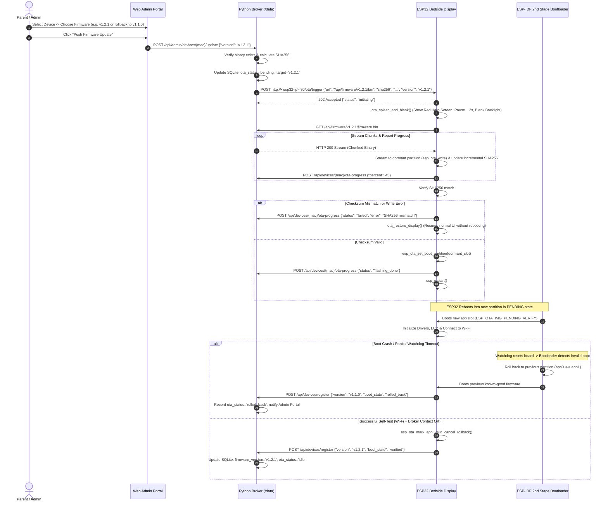

# Feature Specification: Broker-Managed Remote OTA Firmware Updates & Version Rollback
**Document ID:** `010-broker_managed_remote_ota_and_rollback`  
**Status:** Approved  
**Component:** Broker Admin UI, Firmware Repository & ESP32 HTTP OTA Client  
**Target Hardware:** Waveshare ESP32-S3-Touch-LCD-4.3B (16MB Flash, Dual OTA Partitions)  

---

## 1. Executive Summary & Purpose
While the standalone controller firmware supports manual OTA via browser upload (`ElegantOTA`) or CLI (`ArduinoOTA`), managing multiple bedside controllers across bedrooms requires a centralized, automated approach.

This specification defines a **Broker-Managed Remote OTA Update & Rollback System**:
1. **Centralized Firmware Binary Storage:** The broker stores built firmware binaries in `/data/firmware/`, cataloging them in SQLite with semantic versioning (`v1.2.0`), git commit hashes, release notes, and SHA-256 integrity checksums.
2. **1-Click Remote Deployment from Web Admin:** Administrators can view the live firmware version running on every registered ESP32 display and push an upgrade to any individual device or all devices simultaneously.
3. **Automated & Manual Version Rollbacks:**
   * **Instant 1-Click Downgrade:** Parents can select any previously cataloged firmware version from the web dashboard and push a rollback to the board.
   * **Firmware Self-Test & Auto-Rollback (Boot Watchdog):** On the ESP32, upon rebooting into a newly flashed partition, the board enters a `pending_verify` state. If the firmware fails to initialize Wi-Fi, locks up, or panics before calling `esp_ota_mark_app_valid_cancel_rollback()`, the ESP-IDF OTA bootloader automatically invalidates the new image and reboots back into the prior known-good partition.
4. **Secure, Pull-Based Execution:** Instead of holding fragile raw TCP upload sockets open across Wi-Fi, the broker issues an update trigger command (`POST /api/admin/devices/<mac>/update`). The controller pulls the binary directly over HTTP (`GET /api/firmware/<version>/firmware.bin`), verifies its SHA-256 hash stream, streams it directly into flash via `esp_ota_write()`, and reboots cleanly.

---

## 2. Technical Architecture & Data Model

### 2.1 Dual OTA Partition Layout (16 MB Flash)
The Waveshare ESP32-S3 board features 16 MB QIO Flash partitioned to support fail-safe A/B rolling updates:

```text
+-----------------------------------------------------------------------+
| Partition Table (16MB QIO Flash)                                      |
+-------------------+----------------+------------+---------------------+
| Name              | Type / Subtype | Size       | Purpose             |
+-------------------+----------------+------------+---------------------+
| nvs               | data / nvs     | 64 KB      | Wi-Fi, NVS tokens   |
| otadata           | data / ota     | 8 KB       | Boot partition flags|
| phy_init          | data / phy     | 4 KB       | RF calibration data |
| app0 (ota_0)      | app / ota_0    | 4.5 MB     | Primary App Slot    |
| app1 (ota_1)      | app / ota_1    | 4.5 MB     | Secondary App Slot  |
| spiffs / storage  | data / spiffs  | 6.8 MB     | Offline caches/fonts|
+-------------------+----------------+------------+---------------------+
```

### 2.2 SQLite Schema Updates (`/data/broker.db`)

```sql
-- 1. Firmware Releases & Binary Catalog
CREATE TABLE firmware_releases (
    version TEXT PRIMARY KEY,          -- e.g. 'v1.2.1'
    release_tag TEXT NOT NULL,         -- e.g. 'v1.2.1-rel'
    file_path TEXT NOT NULL,           -- '/data/firmware/firmware_v1.2.1.bin'
    file_size_bytes INTEGER NOT NULL,  -- e.g. 2359296
    sha256_hash TEXT NOT NULL,         -- 64-character hex hash
    git_commit TEXT DEFAULT '',        -- '7a35e53'
    release_notes TEXT DEFAULT '',     -- Changelog / markdown summary
    is_active_latest BOOLEAN DEFAULT 0,-- Flag for recommended default version
    created_at DATETIME DEFAULT CURRENT_TIMESTAMP
);

-- 2. Registered Devices (Enhanced with OTA Status & Target Tracking)
-- Extends the esp32_devices table:
ALTER TABLE esp32_devices ADD COLUMN target_firmware_version TEXT REFERENCES firmware_releases(version);
ALTER TABLE esp32_devices ADD COLUMN ota_status TEXT DEFAULT 'idle'; 
-- ota_status values: 'idle', 'pending', 'downloading', 'flashing', 'success', 'failed', 'rolled_back'
ALTER TABLE esp32_devices ADD COLUMN ota_progress INTEGER DEFAULT 0; -- 0 to 100%
ALTER TABLE esp32_devices ADD COLUMN ota_last_error TEXT DEFAULT '';
ALTER TABLE esp32_devices ADD COLUMN previous_firmware_version TEXT DEFAULT '';
```

---

## 3. Remote OTA Lifecycle & State Machine



---

## 4. REST API Endpoint Additions

### 4.1 Admin Firmware Management

#### `GET /api/admin/firmware`
Lists all uploaded firmware versions stored on the broker.
* **Auth:** Admin Session
* **Response (`200 OK`):**
  ```json
  [
    {
      "version": "v1.2.1",
      "release_tag": "Latest Stable",
      "file_size_bytes": 2457812,
      "sha256_hash": "e3b0c44298fc1c149afbf4c8996fb92427ae41e4649b934ca495991b7852b855",
      "git_commit": "7a35e53",
      "release_notes": "Added dual-tab Audiobookshelf catalog and seasonal highlight shelf.",
      "is_active_latest": true,
      "created_at": "2026-10-25T18:00:00Z"
    },
    {
      "version": "v1.2.0",
      "release_tag": "Previous Stable",
      "file_size_bytes": 2411008,
      "sha256_hash": "a1b2c3d4...",
      "git_commit": "ede4c6c",
      "release_notes": "Initial release with SQLite support.",
      "is_active_latest": false,
      "created_at": "2026-10-20T12:00:00Z"
    }
  ]
  ```

#### `POST /api/admin/firmware/upload`
Uploads a newly compiled `firmware.bin` from PlatformIO directly into `/data/firmware/`.
* **Auth:** Admin Session
* **Payload:** `multipart/form-data` with `file`, `version` (e.g. `v1.2.1`), `release_notes`.
* **Broker Actions:** Computes SHA-256 hash, parses ELF headers to verify ESP32-S3 binary architecture, saves to disk, records in `firmware_releases`.

#### `POST /api/admin/devices/<mac_address>/update`
Commands a specific controller to pull and flash a target firmware version (or rollback to an earlier version).
* **Auth:** Admin Session
* **Payload:**
  ```json
  {
    "version": "v1.2.0",
    "force": false
  }
  ```
* **Response (`200 OK`):** `{"ok": true, "status": "update_initiated", "target": "v1.2.0"}`

#### `POST /api/admin/devices/update-all`
Dispatches rolling batch updates across all approved ESP32 hardware displays with an optional staging delay (e.g., 30s) between devices to prevent LAN congestion.
* **Auth:** Admin Session

---

### 4.2 Controller Pull & Progress Telemetry Endpoints

#### `GET /api/firmware/<version>/firmware.bin`
Streams the binary firmware image to the ESP32.
* **Auth:** None (LAN Trusted)
* **Headers:** Returns `Content-Type: application/octet-stream`, `X-SHA256: <hash>`, `Content-Length: <size>`.

#### `POST /api/devices/<mac_address>/ota-progress`
Telemetry endpoint called by the ESP32 during the streaming write process so the Web Admin UI can display a real-time progress bar.
* **Payload:**
  ```json
  {
    "status": "flashing",
    "progress": 68,
    "bytes_written": 1671168,
    "total_bytes": 2457812
  }
  ```

---

## 5. Firmware Implementation Specifications (ESP32-S3)

### 5.1 ESP-IDF Self-Test & Rollback API
To support automatic hardware watchdog rollbacks, the firmware utilizes native `esp_ota` subsystem calls:

```cpp
#include "esp_ota_ops.h"

void check_and_validate_boot() {
    const esp_partition_t *running = esp_ota_get_running_partition();
    esp_ota_img_states_t ota_state;
    
    if (esp_ota_get_state_partition(running, &ota_state) == ESP_OK) {
        if (ota_state == ESP_OTA_IMG_PENDING_VERIFY) {
            Serial.println("[OTA] Firmware running in PENDING_VERIFY mode. Running diagnostic self-test...");
            
            // Self-Test Verification Gates:
            // 1. Wi-Fi connection verified
            // 2. Broker health check endpoint returned HTTP 200
            // 3. Display driver initialized successfully without DMA underruns
            bool test_passed = run_hardware_self_test();
            
            if (test_passed) {
                Serial.println("[OTA] Self-test PASSED! Confirming firmware partition permanently.");
                esp_ota_mark_app_valid_cancel_rollback();
            } else {
                Serial.println("[OTA] Self-test FAILED! Forcing immediate rollback to previous partition.");
                esp_ota_mark_app_invalid_rollback_and_reboot();
            }
        }
    }
}
```

### 5.2 Flash Blanking Integration
The firmware reuses the existing `ota_splash_and_blank()` function:
1. Displays the red `"Loading new software / Please wait..."` screen.
2. Holds for 1.2 seconds to ensure parents/children see what is occurring.
3. Disables the CH422G backlight (`EXIO_BL_DISP = false`) while streaming flash writes to prevent PSRAM memory contention and screen tearing.
4. On reboot, the display driver re-asserts backlight smoothly.

---

## 6. Admin Portal UI Blueprint (Hardware & OTA Tab)

```text
+-----------------------------------------------------------------------------------------------+
|  HARDWARE & BEDROOM CONTROLLERS                                 [+ Upload New Firmware (.bin)] |
+-----------------------------------------------------------------------------------------------+
| Device Friendly Name       | MAC Address       | Current Ver | Target Ver | Status    | Actions  |
+----------------------------+-------------------+-------------+------------+-----------+----------+
| Oliver's Bedside Display   | c4:4f:33:11:22:aa | v1.2.1      | v1.2.1     | 🟢 Online | [Update] |
| Maya's Bedroom Display     | c4:4f:33:11:22:bb | v1.2.0      | v1.2.1     | 🟠 Flashing 65%      |
| Playroom Shared Display    | c4:4f:33:11:22:cc | v1.2.1      | v1.1.0     | 🟢 Online | [Rollback]|
+-----------------------------------------------------------------------------------------------+

[Modal Dialog: Firmware Update & Rollback]
Select Firmware Version for Oliver's Bedside Display:
(•) v1.2.1 (Latest Stable - Released Oct 25, 2026) [CURRENT]
( ) v1.2.0 (Stable - Released Oct 20, 2026)
( ) v1.1.0 (Legacy Base - Released Oct 15, 2026) [ROLLBACK TARGET]

Changelog for v1.1.0:
- Base release with single-tab Yoto card browsing and basic playback controls.

[ Cancel ]                                                    [ Confirm & Push Update ]
```

---

## 7. Verification & Acceptance Criteria
1. **Successful 1-Click Update:** Uploading `v1.2.1.bin` and clicking update on a device successfully flashes the dormant partition and boots cleanly.
2. **1-Click Rollback:** Selecting `v1.2.0` from the version dropdown immediately rolls the device back to the earlier version.
3. **Automated Recovery on Faulty Firmware:** Intentionally flashing an invalid binary or a test build with an artificial boot panic causes the bootloader to revert to the previous working partition within 15 seconds without user intervention.
4. **Zero NVS Data Loss:** Rolling back or updating maintains all child profiles, Wi-Fi keys, and tokens.
