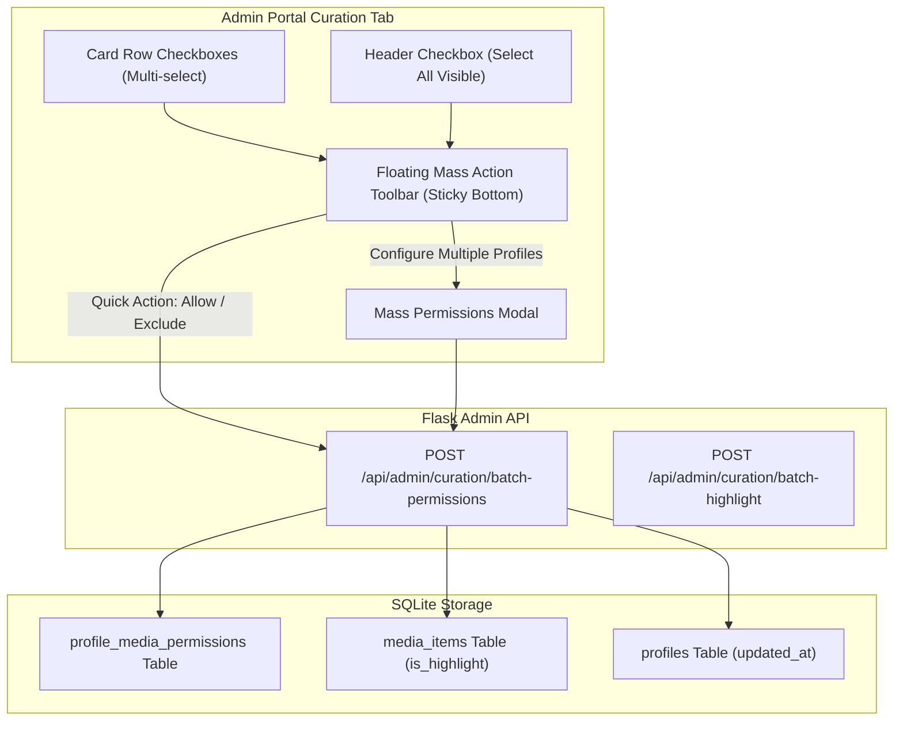

# Feature Specification: Curation Matrix Multi-Card Mass Edit & Bulk Profile Access
**Document ID:** `011-curation_matrix_mass_edit_and_bulk_permissions`  
**Status:** In Progress / Draft  
**Component:** Broker Web Admin UI & Curation Engine  
**Target Platform:** Python Flask Embedded SPA (`yoto-esp32-broker/sample app`)  

---

## 1. Executive Summary & Purpose

The **Unified Curation Matrix** allows parents to configure card access, seasonal highlights, and child-specific permissions across hundreds of physical Yoto cards, MYO playlists, and Audiobookshelf audiobooks. 

Prior to this feature, adjusting permissions required opening the individual **"⚙️ Permissions"** modal on each card one-by-one. For household libraries containing 200+ cards and multi-book series (e.g., 30 *BrainBots* titles, 7 *Harry Potter* books, 10 *Disney* collections), individual editing created unacceptable administrative friction.

The **Multi-Card Mass Edit Feature** introduces:
1. **Multi-Card Selection:** Interactive row checkboxes, Shift-Click range selection, "Select All Visible" (filtered view), and "Select Entire Catalog".
2. **Docked Bulk Action Toolbar:** A responsive, glassmorphic floating action bar that slides into view upon item selection, providing one-click batch operations (**Grant Access**, **Restrict Access**, **Reset to Inherited Defaults**, and **Toggle Highlight ⭐**).
3. **Mass Edit Permissions Modal:** A dedicated modal for fine-grained multi-profile configuration, displaying a visual summary of selected items (by source type: Yoto Retail, MYO, ABS) and offering per-profile action switches.
4. **Atomic SQLite Batch Endpoints:** High-performance, transaction-safe backend endpoints (`POST /api/admin/curation/batch-permissions` and `POST /api/admin/curation/batch-highlight`) executing hundreds of permission changes in a single database transaction.

---

## User Review Required

> [!IMPORTANT]
> **Key Architecture Decisions for Mass Editing:**
> 1. **Batch Backend Endpoint vs. Sequential Requests:**
>    Instead of sending dozens of individual HTTP requests when a user edits 50+ cards at once, we introduce an atomic endpoint: `POST /api/admin/curation/batch-permissions`.
>    - Payload: `{ "media_ids": [...], "profile_actions": { "<profile_id>": "allow" | "exclude" | "reset" }, "set_highlight": true | false | null }`.
> 2. **Handling Audiobookshelf (ABS) Items vs. Yoto Items in Mass Edit:**
>    - **Yoto Cards (Retail & MYO):** Direct permission assignment (`allowed_card_ids` / `excluded_card_ids` in `profile_media_permissions`).
>    - **ABS Items:** In ABS, child permissions are driven by server tags (e.g. `Children`). While broker-level exclusions can block an ABS book for a child, explicit allowances on non-tagged ABS books either require updating ABS tags or applying broker-level overrides.
>    - *Design Decision:* The mass edit modal will clearly label what actions apply to Yoto vs. ABS items, and allow bulk exclusion or inclusion across all selected cards.
> 3. **Selection Scope:**
>    - Support selecting individual checkboxes, selecting all currently visible (filtered) cards, and an option to "Select all [N] discovered cards in library".

---

## Proposed Changes



---

### Backend API & Database

#### [MODIFY] `sample app/database.py`
- Add `batch_update_profile_media_permissions(media_ids: List[str], profile_actions: Dict[str, str]) -> Dict[str, Any]`
  - Takes a list of `media_ids` and a dict mapping `profile_id -> "allow" | "exclude" | "reset"`.
  - Executes atomically within a transaction:
    - `"allow"`: Deletes existing exclusion, inserts `allowed` permission.
    - `"exclude"`: Deletes existing allowance, inserts `excluded` permission.
    - `"reset"`: Removes both explicit `allowed` and `excluded` records so the card falls back to default household inheritance rules.
- Add `batch_update_media_highlight(media_ids: List[str], is_highlight: bool) -> int`
  - Sets `is_highlight = 1` or `0` for the given IDs in a single `UPDATE media_items WHERE id IN (...)`.

#### [MODIFY] `sample app/routes/admin_curation.py`
- Add route `POST /api/admin/curation/batch-permissions`:
  - Request body:
    ```json
    {
      "media_ids": ["7gGiV", "3JvKE", "5L55K"],
      "profile_actions": {
        "jackson": "allow",
        "wesley": "exclude"
      },
      "is_highlight": null
    }
    ```
  - Validates `media_ids` (must be non-empty list) and `profile_actions`.
  - Calls `database.batch_update_profile_media_permissions`.
  - Returns `{ "ok": true, "updated_cards": 3, "affected_profiles": 2 }`.

---

### Frontend UI & Aesthetics

#### [MODIFY] `sample app/templates/admin.html`
1. **Header Checkbox in `#matrixTable`:**
   - Add `<th style="width: 38px; text-align: center;"><input type="checkbox" id="matrixSelectAll" onchange="toggleSelectAllMatrix(this.checked)"></th>` to `<thead>`.
2. **Floating Bulk Action Bar (`#curationBulkBar`):**
   - Positioned fixed at bottom of viewport (`bottom: 24px`, glassmorphic dark theme, sleek slide-up animation when items are selected).
   - Displays:
     - `Selected: <span id="bulkSelectedCount">0</span> cards`
     - Quick buttons:
       - 🟢 **Allow For...** (Dropdown of profiles or opens modal)
       - 🔴 **Exclude For...**
       - ⭐ **Toggle Highlight (On/Off)**
       - ⚙️ **Mass Edit Permissions** (Opens detailed modal)
       - ✕ **Clear Selection**
3. **Mass Permissions Modal (`#curationMassEditModal`):**
   - Allows choosing target profile(s) and applying bulk permission actions:
     - **Grant Access (Allowed)**: Adds to child's explicit allowed list.
     - **Restrict Access (Excluded)**: Explicitly blocks the card from this child.
     - **Reset to Inherited Rules (Clear)**: Reverts to household shared rules.
   - Shows summary of selected media breakdown (e.g. "32 cards selected: 24 Yoto Retail, 4 MYO, 4 Audiobookshelf").

#### [MODIFY] `sample app/static/js/admin.js`
- Manage selection state via `Set` of selected IDs (`selectedMatrixItemIds = new Set()`).
- Add row checkbox rendering in `renderMatrixTable()`:
  - Checkbox per row with `onclick="toggleMatrixItemSelect('${item.id}', this.checked, event)"`.
  - Shift-click support for range selection.
- Update `filterMatrix()` to ensure "Select All" respects current search/filter view:
  - If a filter is active (e.g. Series: *Harry Potter*), "Select All" selects only visible rows, with an option banner: *"All 4 visible cards selected. Select all 201 cards in catalog?"*
- Implement `applyBulkPermissions(profileId, action)` and `saveMassEditModal()`.
- Refresh matrix seamlessly without resetting pagination or view filters.

#### [MODIFY] `sample app/static/css/admin.css`
- Add styles for:
  - `.bulk-action-bar`: Glassmorphic bottom banner (`backdrop-filter: blur(12px)`, gradient border, subtle glow, smooth slide-up transition).
  - Selected row highlight: `tr.row-selected { background: rgba(99, 102, 241, 0.08) !important; }`.
  - Modern rounded checkboxes matching dark mode UI.

---

## Verification Plan

### Automated Tests
1. **Database Unit Tests:**
   - Test batch allow, batch exclude, and batch reset operations across multiple profiles in `tests/test_curation_matrix.py`.
   - Verify transaction rollback on partial failure.
2. **API Endpoint Tests:**
   - Test `POST /api/admin/curation/batch-permissions` with valid tokens, unauthenticated 401 checks, and payload validation.

```bash
python -m unittest discover tests
```

### Manual Verification
1. Open Admin Portal `http://192.168.1.72:5000/admin` (or local port).
2. Navigate to **Curation** tab.
3. Select 3 Harry Potter cards using row checkboxes.
4. Verify the floating bulk action bar slides up showing "3 cards selected".
5. Use **Mass Edit Permissions** to allow the 3 cards for child "Wesley" and exclude for child "Jackson".
6. Confirm the matrix table badges update immediately (green pill for Wesley, red/excluded pill for Jackson).
7. Test "Select All Visible" when filtering by Series "BrainBots".
