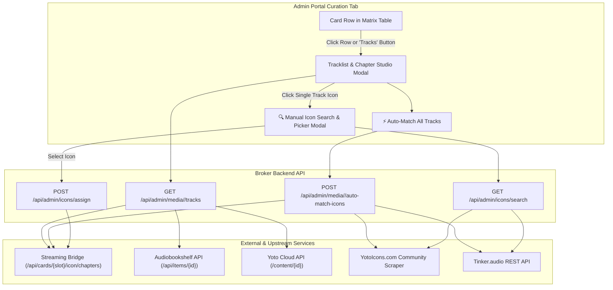

# Feature Specification: Tracklist Browser & Chapter Artwork Studio
**Document ID:** `012-tracklist_browser_and_chapter_artwork_studio`  
**Status:** Completed / Implemented  
**Component:** Broker Web Admin UI & Icon Engine  
**Target Platform:** Python Flask Embedded SPA (`yoto-esp32-broker/sample app`)  

---

## 1. Executive Summary & Purpose

Parents and children frequently need to inspect tracklists, chapter breakdowns, track durations, and display icons on household cards. 

Commercial / Retail Yoto cards already come with official curated icons created by Yoto, requiring read-only inspection. However, custom **Make Your Own (MYO)** playlists and **Audiobookshelf (ABS)** audiobooks often have chapters that lack pixel art or have not been set up with icons.

The **Tracklist & Chapter Artwork Studio** introduces:
1. **Unified Card Tracklist & Chapter Browser Modal:** An interactive studio accessible by clicking any card row or "🎵 Tracks" in the Curation Matrix. Displays full titles, durations, track indices, and 16×16 display icons.
2. **Commercial / Retail Yoto Cards (Read-Only):** Retail cards (e.g., Harry Potter 1–4, Disney, BrainBots) already possess official curated icons. The studio renders their full tracklists, running times, and official 16×16 icons in a read-only view to prevent overwriting official commercial assets.
3. **Editable ABS & MYO Chapter Artwork:** For self-hosted audiobooks and family MYO playlists where icons have not been configured, provides full chapter artwork editing.
4. **1-Click Auto-Match Engine:** For ABS and MYO cards, evaluates track titles against Tier 0 (Yoto store/library), Tier 1 (YotoIcons tags), and Tier 2 (Tinker) to automatically assign matching pixel art across all chapters in one pass.
5. **Interactive Icon Search & Picker (MYO Studio Style):** A manual search modal with category filters, popular community tags, and instant preview for assigning custom pixel art to individual chapters.
6. **Live Upstream Sync:** Automatically uploads and applies assigned chapter icons to the local Streaming Bridge (`/api/cards/{slot}/icon/chapters`) and Yoto Cloud, ensuring physical Yoto players display the custom artwork during playback.

---

## User Review Required

> [!IMPORTANT]
> **Key Architecture Decisions:**
> 1. **Card Type Support & Capabilities:**
>    - **Commercial / Retail Yoto Cards (e.g. Harry Potter 1–4, Disney, BrainBots):**
>      - Read-only inspection. Displays the official chapters/tracks, chapter durations, track numbers, and official Yoto 16×16 display icons directly from Yoto Cloud via `GET /api/yoto/card/{card_id}`.
>    - **Audiobookshelf (ABS) Books:**
>      - Full chapter breakdown from ABS. 
>      - For each chapter: displays title, duration, and current 16×16 pixel art icon.
>      - When an icon is assigned, it saves to broker disk cache and syncs to the local Streaming Bridge (`PUT /api/cards/{slot}/icon/chapters/{item_id}/{chapter_num}`) so the physical Yoto player shows the icon during playback.
>    - **Make Your Own (MYO) Playlists:**
>      - Fetches tracks from Yoto Cloud / Bridge.
>      - Allows replacing 16×16 icons per track/chapter and updating the playlist upstream.
> 2. **Two-Stage Icon Assignment Workflow:**
>    - **Option 1: "⚡ Auto-Match Track Icons" (1-Click Batch):**
>      - Sequentially searches Tier 0 (Yoto library matches), Tier 1 (YotoIcons community tags matching chapter titles like "Chapter 1", "Train", "Dragon"), and Tier 2 (Tinker).
>      - Automatically assigns the highest confidence icon to each chapter without manual intervention.
>    - **Option 2: "🔍 Manual Search & Icon Picker" (MYO Studio Style):**
>      - Clicking any individual chapter's icon opens an inline icon search drawer/picker.
>      - Parents can type custom keywords (e.g., "wand", "potion", "cat", "castle"), browse popular/trending community icons, preview live, and click to apply.

---

## Proposed Changes



---

### Backend API

#### [MODIFY] `sample app/routes/admin_curation.py`
- Add `GET /api/admin/media/<media_id>/tracks`:
  - Determines media type (`abs`, `yoto_myo`, `yoto`).
  - **For `abs`:** Fetches chapters from `clients.abs_client.get_item(media_id)`. Also checks Bridge (`GET /api/cards/{slot}/icon/chapters`) if mapped to a slot to retrieve custom pictures. Returns list of `{ number, title, duration, start, end, icon_url, can_edit: true }`.
  - **For `yoto` / `yoto_myo`:** Calls Bridge `GET /api/yoto/card/{media_id}` or direct Yoto Cloud. Extracts `content.chapters` with duration, `display.icon16x16`, and tracks. Sets `can_edit: (is_myo or bridge_card)`.
- Add `POST /api/admin/media/<media_id>/auto-match-icons`:
  - Iterates through all chapters/tracks.
  - Queries `IconEngine.search_all_sources(clean_track_title)`.
  - If match found, downloads and assigns via `PUT /api/cards/{slot}/icon/chapters/{item}/{n}` on Bridge and caches locally.
  - Returns `{ ok: true, matched_count: N, total_tracks: M }`.

#### [MODIFY] `sample app/clients/yoto_client.py`
- Add `get_card_detail(card_id: str) -> Optional[Dict[str, Any]]`:
  - Calls Bridge `GET {bridge_url}/api/yoto/card/{card_id}` with 15s timeout.
  - Falls back to Direct Cloud `GET {API_URL}/content/{card_id}` if authenticated.

---

### Frontend UI & Aesthetics

#### [MODIFY] `sample app/templates/admin.html`
1. **Tracklist & Chapter Studio Modal (`#curationTracklistModal`):**
   - Header with card cover thumbnail, large title, author, badge type (`YOTO Retail`, `MYO`, `Audiobookshelf`), total duration, and track count.
   - Action Bar:
     - `⚡ Auto-Match All Icons` (visible for ABS and MYO cards).
     - Status indicator (e.g., "18 / 18 tracks have custom icons").
   - Scrollable Track Table / Cards:
     - Track # | 16×16 Icon (interactive if editable, with hover pencil ✏️) | Track Title | Duration | Actions ("Change Icon", "Reset").
2. **Interactive Icon Search & Picker Modal (`#iconSearchPickerModal`):**
   - Embedded search bar (pre-filled with chapter title or book title).
   - Category tags: All, Animals, Characters, Nature, Transportation, Fantasy, School, Numbers.
   - Grid of 16×16 pixel art icons (scaled up to 48×48 with crisp `image-rendering: pixelated;`).
   - One-click selection to apply immediately.

#### [MODIFY] `sample app/static/js/admin.js`
- Add click handler to table rows or "🎵 Tracks" action button to invoke `openTracklistModal(mediaId)`.
- Implement `renderTracklistModal(mediaId, tracksData)`.
- Implement `autoMatchAllTrackIcons(mediaId)`.
- Implement `openSingleTrackIconPicker(mediaId, trackNumber, trackTitle)`.
- Implement `assignIconToTrack(mediaId, trackNumber, iconUrl)`.

#### [MODIFY] `sample app/static/css/admin.css`
- Styling for:
  - Tracklist table (`.tracklist-table` with subtle zebra striping, duration badges, and sticky headers).
  - Pixel art icon button (`.track-icon-btn` with hover glow, zoom effect, and edit badge).
  - Icon picker grid (`.icon-picker-grid` with responsive cards and active selection rings).

---

## Verification Plan

### Automated Tests
1. **API Unit Tests (`tests/test_tracklist_and_icons.py`):**
   - Test `GET /api/admin/media/<id>/tracks` for ABS book (returns all chapters with durations).
   - Test `GET /api/admin/media/<id>/tracks` for Yoto card (returns all 18 chapters for `7gGiV` with Yoto 16x16 icon URLs).
   - Test `POST /api/admin/media/<id>/auto-match-icons` mock run.
2. **Icon Engine Tests:**
   - Verify `search_all_sources("Hogwarts")` returns valid YotoIcons results.

```bash
python -m unittest discover tests
```

### Manual Verification
1. Open Admin Portal `http://192.168.1.72:5000/admin` -> Curation Tab.
2. Click on **Harry Potter and the Sorcerer's Stone** (`7gGiV`):
   - Verify modal opens showing all 18 chapters ("Chapter One: The Boy Who Lived", etc.), duration (29:20), and official Yoto 16x16 pixel art icons.
   - Verify edit buttons are disabled/read-only for official commercial retail cards.
3. Click on an **Audiobookshelf** book (e.g. *The Boxcar Children Collection*):
   - Verify all 43 chapters appear.
   - Click **⚡ Auto-Match All Icons** -> Watch progress indicator assign icons.
   - Click an individual chapter's icon -> Search for "train" -> Select locomotive icon -> Verify track icon updates immediately.
