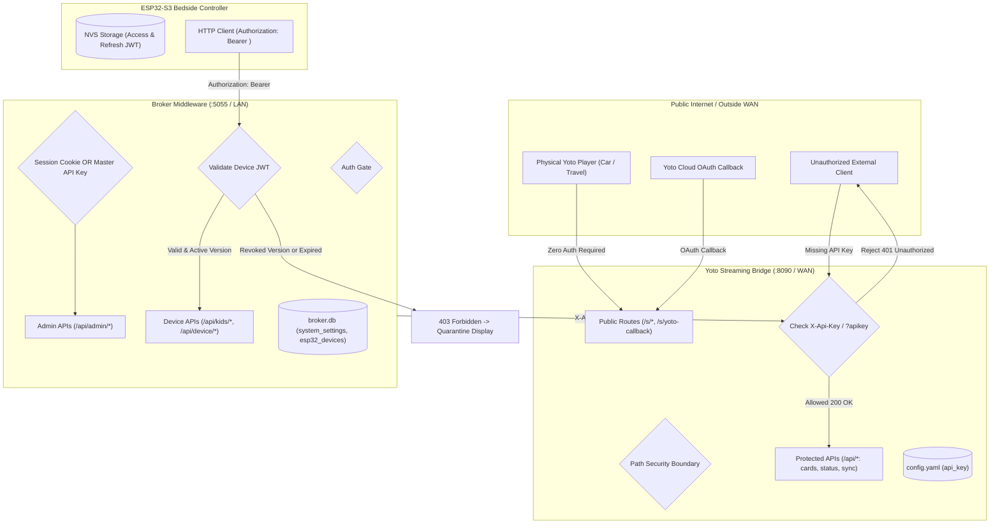

# Feature 013: Master API Tokens & Per-Device Rotating JWT Security Architecture

**Feature ID:** `FEATURE_013_SECURITY_TOKENS_JWT`  
**Status:** Approved Specification / Active Phase 1 Deliverable  
**Author:** Antigravity Engineering  
**Target Repositories:**  
* `projects/yoto-esp32-broker` (Broker Middleware & Admin Portal)  
* `yoto-audiobookshelf-bridge` (Local / Cloud Streaming Bridge)  
* `homelab-setup` (Docker Compose stacks)

---

## 1. Executive Summary & Objective

The Yoto Bedside ecosystem consists of public cloud endpoints, local Docker microservices, reverse proxies, and physical battery/mains-powered ESP32-S3 bedside touchscreens. Because the Yoto Streaming Bridge (`https://yoto.ohiodeans.us`) is publicly reachable over the WAN to serve MP3 streams to mobile Yoto players, securing management interfaces and internal APIs against unauthorized access, credential scraping, and replay attacks is essential.

This specification implements a dual-tier security architecture utilizing **Master API Tokens** and modern **RFC 9068 / RFC 6750 token standards**:
1. **Master API Keys:** 32-character hex tokens generated natively by both the Streaming Bridge and the Broker. Viewable, copyable, and regenerable via the web UI with confirmation gates.
2. **Per-Device Rotating JWTs for ESP32 Controllers:** Microcontrollers never receive master API keys. Instead, approved devices are assigned a unique 256-bit cryptographic secret, rotating a 24-hour Access Token and 30-day Refresh Token, backed by instant admin revocation.
3. **Preserved Public Streaming Exemption:** WAN audio streams (`/s/*.mp3`), pixel art icons (`/s/icon/*`), health checks (`/s/health`), and OAuth callbacks (`/s/yoto-callback`) remain completely open without credentials, ensuring zero disruption to physical Yoto player playback anywhere in the world.

---

## 2. Threat Model & Security Boundaries



### Security Boundary Matrix

| Zone | Endpoints | Authentication Gate | Justification |
| :--- | :--- | :--- | :--- |
| **Bridge Public Streaming** | `/s/*.mp3`, `/s/icon/*`, `/s/health` | **None (Completely Open)** | Physical Yoto players cannot supply custom auth headers or cookies when streaming audio over WAN. |
| **Bridge OAuth Callback** | `/s/yoto-callback` | **None (Open)** | Receives authorization code redirects directly from Yoto Cloud auth servers. |
| **Bridge Management & Sync** | `/api/status`, `/api/yoto/*`, `/api/cards/*`, `/api/books/*` | **Bridge API Key** (`X-Api-Key` or `?apikey=`) | Blocks external scraping, unauthorized sync triggers, and data leakage. |
| **Broker Admin Management** | `/api/admin/*` | **Session Cookie OR Broker Master API Key** | Dual-gate allows browser admin sessions or external automation (Home Assistant, scripts). |
| **Broker ESP32 Controller** | `/api/kids/*`, `/api/device/*`, `/api/items/*` | **Per-Device Rotating JWT** (`Bearer <token>`) | Cryptographically isolates hardware; flash dumping cannot compromise master system keys. |

---

## 3. Component Architecture & Detailed Design

### 3.1 Master API Keys (Bridge & Broker)

#### Token Specifications
* **Format:** 32-character lowercase hexadecimal string (`[a-f0-9]{32}`).
* **Entropy:** 128-bit cryptographically secure pseudorandom number generator (`secrets.token_hex(16)`).
* **Comparison Standard:** Constant-time equality checks using `hmac.compare_digest()` to eliminate timing attacks.

#### Authentication Resolution Order
Incoming requests to protected management endpoints evaluate credentials in the following order:
1. `X-Api-Key: <key>` header (Primary standard matching Sonarr / Radarr).
2. `Authorization: Bearer <key>` header (RFC 6750 standard).
3. `?apikey=<key>` query parameter (**GET requests only**; mutating `POST`, `PUT`, or `DELETE` requests disallow query-param authentication to prevent proxy logging).

#### Bridge Key Management (`yoto-audiobookshelf-bridge`)
1. **Initial Boot Auto-Generation:** On initial boot, `yotobridge/config.py` checks for `api_key` in `config.yaml`. If null or empty, it generates a key, writes it to `config.yaml`, and logs notice of creation.
2. **On-Demand Key Regeneration:**
   - **Endpoint:** `POST /api/security/regenerate-key`
   - **Payload:** Requires existing valid API key (or admin secret).
   - **Action:** Generates a new key, writes back to `config.yaml`, hot-reloads running instance, and returns the new key.
   - **Protection:** All outstanding API keys are instantly invalidated.

#### Broker Key Management (`yoto-esp32-broker`)
1. **Persistence:** Stored in SQLite table `system_settings` under key `master_api_key`.
2. **Settings UI Display:** Displayed in the Admin Portal under **Tab 4 (Settings)**:
   - Masked by default (`••••••••••••••••••••••••••••••••`).
   - Clickable 👁️ eye toggle reveals plaintext.
   - One-click 📋 Copy button with toast notification.
   - **"🔄 Regenerate API Key"** button opens a high-visibility warning modal.
3. **Bridge Integration Link:** The Broker stores the target Bridge URL and the Bridge's API key in `system_settings` (`yoto_bridge_api_key`). All outbound queries from the Broker's `YotoClient` automatically attach `X-Api-Key: <bridge_key>`.

---

### 3.2 Microcontroller (ESP32-S3) Rotating JWT Architecture

Microcontrollers operating in children's bedrooms present unique physical security constraints:
* Microcontroller flash can be dumped via physical UART pins.
* Devices can be unplugged or relocated.
* Hardcoding administrative credentials on hardware is a critical security vulnerability.

#### Per-Device Cryptographic Isolation
When an ESP32 is approved in the Broker Admin Portal **Hardware Tab**, the Broker creates a unique 256-bit HMAC-SHA256 secret for that specific MAC address:

```sql
-- Schema addition to esp32_devices
ALTER TABLE esp32_devices ADD COLUMN jwt_secret TEXT DEFAULT '';
ALTER TABLE esp32_devices ADD COLUMN token_version INTEGER DEFAULT 1;
ALTER TABLE esp32_devices ADD COLUMN last_token_issued DATETIME;
```

#### Dual-Token Lifecycle
1. **Initial Provisioning (Handshake):**
   - ESP32 boots and issues `POST /api/device/register` with `{"mac": "c44f331122aa", "firmware": "1.0.4"}`.
   - If device is **Pending Approval**, Broker responds `202 Accepted` with `{"status": "pending_approval"}`. ESP32 renders a pairing PIN screen.
   - Once Admin clicks **"Approve"** in the UI, the Broker assigns a profile, generates `jwt_secret`, and returns an initial token pair:
     - **Access Token:** Valid for **24 hours** (`86,400s`).
     - **Refresh Token:** Valid for **30 days** (`2,592,000s`).
   - The ESP32 writes both tokens to flash using the ESP-IDF Non-Volatile Storage (NVS) API.

2. **Daily Refresh Operation:**
   - Every 12 to 20 hours (or upon waking/rebooting), the ESP32 calls `POST /api/device/auth/refresh`:
     ```json
     {
       "mac": "c44f331122aa",
       "refresh_token": "eyJhbGciOiJIUzI1NiIsInR5cCI6IkpXVCJ9..."
     }
     ```
   - Broker verifies the refresh token signature against that device's `jwt_secret`, checks that `token_version` matches the database, and issues a fresh 24-hour access token.

3. **Claims Payload (Compact for Microcontroller RAM):**
   ```json
   {
     "sub": "esp32_c44f331122aa",
     "prof": "child_one",
     "ver": 1,
     "type": "access",
     "iat": 1792650000,
     "exp": 1792736400
   }
   ```

4. **Zero-Delay Admin Revocation:**
   - An administrator can click **"🔒 Revoke Access"** or toggle **"Approved: False"** on any device in the Hardware tab.
   - The Broker executes `UPDATE esp32_devices SET token_version = token_version + 1, is_approved = 0 WHERE mac = ?`.
   - The next request sent by that ESP32 (even if its access token has 23 hours remaining) immediately fails validation because `ver` does not match the active database version.
   - The ESP32 receives `403 Forbidden` with `{"error": "device_revoked"}`, clears its NVS cache, and returns to the quarantine pairing screen.

---

## 4. API Endpoints Specification

### 4.1 Broker Master API Key Endpoints

#### `GET /api/admin/security/api-key`
Fetches the active master API key for administrative display.
* **Auth:** Active Admin Session Cookie OR Master API Key
* **Response (`200 OK`):**
  ```json
  {
    "api_key": "9f8e7d6c5b4a32109f8e7d6c5b4a3210",
    "created_at": "2026-10-25T14:00:00Z",
    "last_used_at": "2026-10-27T09:12:00Z"
  }
  ```

#### `POST /api/admin/security/regenerate-api-key`
Regenerates the master API key, invalidating all external integrations until updated.
* **Auth:** Active Admin Session Cookie OR Master API Key
* **Request Body:**
  ```json
  {
    "confirm": true
  }
  ```
* **Response (`200 OK`):**
  ```json
  {
    "status": "success",
    "new_api_key": "1a2b3c4d5e6f7a8b9c0d1e2f3a4b5c6d",
    "message": "Master API key regenerated. All external clients must be updated."
  }
  ```

---

### 4.2 ESP32 Token Handshake & Refresh Endpoints

#### `POST /api/device/auth/refresh`
Refreshes an expiring or expired access token using the device's persistent refresh token.
* **Auth:** Valid Refresh Token in body
* **Request Body:**
  ```json
  {
    "mac": "c44f331122aa",
    "refresh_token": "eyJhbGciOiJIUzI1NiIsInR5cCI..."
  }
  ```
* **Response (`200 OK`):**
  ```json
  {
    "access_token": "eyJhbGciOiJIUzI1NiIsInR5cCI...",
    "expires_in": 86400,
    "token_type": "Bearer"
  }
  ```
* **Error Response (`403 Forbidden`):**
  ```json
  {
    "error": "token_revoked",
    "message": "This device has been unapproved or revoked by an administrator."
  }
  ```

#### `POST /api/admin/devices/<mac>/revoke`
Admin action to instantly revoke a specific ESP32 controller.
* **Auth:** Admin Session Cookie OR Master API Key
* **Response (`200 OK`):**
  ```json
  {
    "status": "revoked",
    "mac": "c44f331122aa",
    "message": "Device tokens invalidated. Device quarantined until re-approved."
  }
  ```

---

### 4.3 Streaming Bridge API Security Endpoints

#### `POST /api/security/regenerate-key`
Regenerates the Bridge's 32-character hex key, saving to `config.yaml` and hot-reloading.
* **Auth:** Current Bridge API Key (`X-Api-Key` or `?apikey=`)
* **Response (`200 OK`):**
  ```json
  {
    "status": "success",
    "new_api_key": "f0e1d2c3b4a59687f0e1d2c3b4a59687",
    "message": "Bridge API key updated in config.yaml."
  }
  ```

---

## 5. UI Blueprint: Admin Portal Security Card

Located in **Tab 4 (Settings & Diagnostics)** of the Broker Web Admin Dashboard:

```text
+----------------------------------------------------------------------------------------------------+
| 🔑 API & Hardware Security                                                                        |
+----------------------------------------------------------------------------------------------------+
| Broker Master API Key                                                                             |
| [ •••••••••••••••••••••••••••••••• ]  [ 👁️ Show ]  [ 📋 Copy ]  [ 🔄 Regenerate Key ]               |
| Use this key to authenticate external services (Home Assistant, scripts, direct API tools).       |
|                                                                                                    |
| Yoto Streaming Bridge API Key                                                                      |
| [ f0e1d2c3b4a59687f0e1d2c3b4a59687                          ]  [ 💾 Save ]  [ ⚡ Test Connection ] |
| Matches the api_key defined in your Yoto Bridge config.yaml.                                      |
+----------------------------------------------------------------------------------------------------+
```

### Confirmation Modal Blueprint: `#regenerateApiKeyModal`
```text
+--------------------------------------------------------------------+
| ⚠️ Warning: Regenerate Master API Key?                             |
+--------------------------------------------------------------------+
| Regenerating your Master API Key will immediately invalidate the   |
| current key. Any external integrations (Home Assistant automations,|
| diagnostic scripts, or third-party webhooks) will cease functioning|
| until updated with the new key.                                    |
|                                                                    |
| [ Cancel ]                               [ 🔄 Yes, Regenerate Key ] |
+--------------------------------------------------------------------+
```

---

## 6. Verification & Acceptance Criteria

### 6.1 Automated Verification Plan
1. **Public Stream Exemption Test:**
   - Execute HTTP GET on `/s/health` $\rightarrow$ Expect `200 OK` with zero headers.
   - Execute HTTP GET on `/s/yoto-callback` $\rightarrow$ Expect valid response or redirect with zero headers.
2. **Bridge Authentication Gate Test:**
   - Execute HTTP GET on `/api/yoto/library` without API key $\rightarrow$ Expect `401 Unauthorized`.
   - Execute HTTP GET on `/api/yoto/library` with `X-Api-Key: <valid_key>` $\rightarrow$ Expect `200 OK`.
   - Execute HTTP GET on `/api/yoto/library?apikey=<valid_key>` $\rightarrow$ Expect `200 OK`.
3. **Constant-Time Verification Test:**
   - Verify `hmac.compare_digest` is used for all key comparisons.
4. **Broker Dual-Gate Test:**
   - Call `/api/admin/catalog/matrix` with session cookie $\rightarrow$ Expect `200 OK`.
   - Call `/api/admin/catalog/matrix` with `X-Api-Key` $\rightarrow$ Expect `200 OK`.
   - Call `/api/admin/catalog/matrix` without cookie or key $\rightarrow$ Expect `401 Unauthorized`.
5. **ESP32 JWT Rotation & Revocation Test:**
   - Query `/api/kids/jackson/yoto` with signed access token $\rightarrow$ Expect `200 OK`.
   - Execute `/api/admin/devices/<mac>/revoke` $\rightarrow$ Expect `200 OK`.
   - Re-query `/api/kids/jackson/yoto` with previously valid access token $\rightarrow$ Expect `403 Forbidden`.

### 6.2 Manual Verification Steps
1. Navigate to Broker Web Admin Dashboard $\rightarrow$ Settings Tab.
2. Verify Master API Key is masked; click 👁️ to reveal plaintext.
3. Click 📋 Copy Key; verify clipboard matches.
4. Click **🔄 Regenerate Key**; verify confirmation modal blocks accidental clicks.
5. In Hardware Tab, locate a registered ESP32 and click **Revoke**; verify device status changes to Quarantined.
