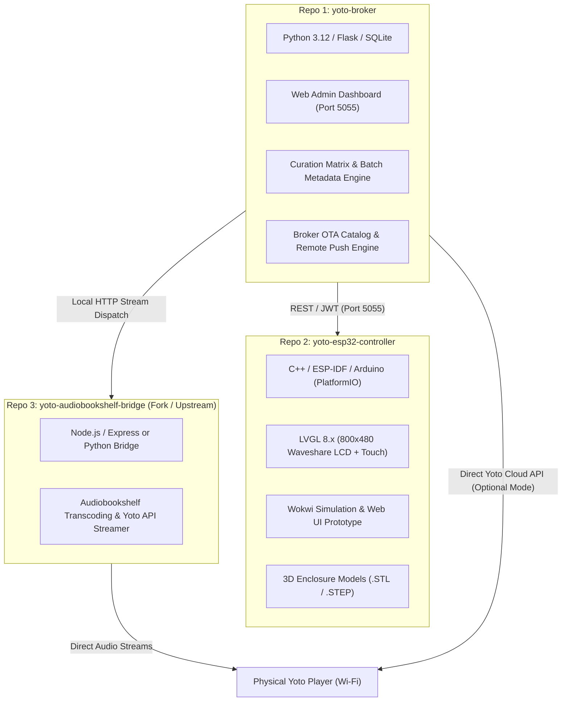
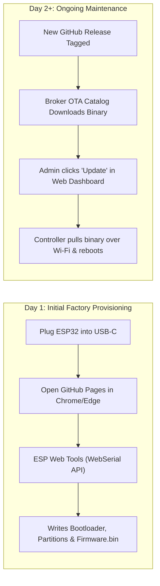
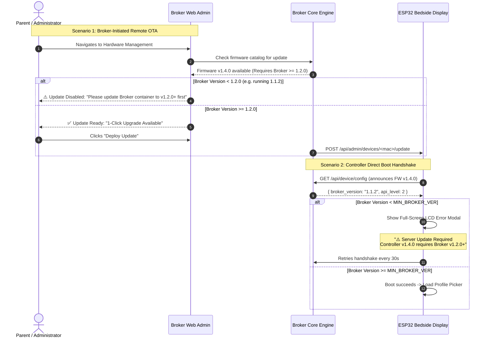

# Technical Implementation Specification: Repository Architecture, Packaging, Release Pipelines & Cross-Component Versioning Contract

**Document ID:** `014-repo_packaging_and_cross_component_versioning`  
**Status:** Approved & Implemented Specification  
**Component:** Multi-Repository Topology, Packaging CI/CD, Semantic Versioning, & Bi-Directional Compatibility Contract  
**Applies To:**  
- `yoto-broker` (Server Hub / Admin Dashboard / Curation Engine)  
- `yoto-esp32-controller` (Bedside Touchscreen Appliance Firmware / Hardware)  
- `yoto-audiobookshelf-bridge` (Upstream / Forked Streaming Bridge Microservice)  

---

## 1. Executive Summary & Purpose

The Yoto Bedside ecosystem consists of three decoupled software components:
1. An audio streaming proxy daemon that bridges Audiobookshelf streams to Yoto players (`yoto-audiobookshelf-bridge`).
2. A centralized home server orchestrator, SQLite database, web admin UI, and metadata curator (`yoto-broker`).
3. An embedded bedside touch appliance running LVGL on an ESP32-S3 microcontroller (`yoto-esp32-controller`).

Because embedded hardware and home servers have vastly different release lifecycles, deployment mechanisms, and runtime dependencies, this document establishes:
- The **three-tier repository boundaries** and release isolation rules.
- The **packaging and distribution pipeline** for server containers (Docker/GHCR) and firmware binaries (ESP Web Tools, PlatformIO, OTA bundles).
- The **Cross-Component Semantic Versioning Contract (`semver`)**, preventing broken device states when controller firmware features outpace older broker deployments.
- The **Bi-Directional Pre-Flight Gate**, enforcing compatibility both broker-side (during remote OTA dispatch) and device-side (during boot handshake).

---

## 2. Multi-Repository Architecture & Ecosystem Topology



### 2.1 Repository Boundary Matrix

| Characteristic | `yoto-broker` | `yoto-esp32-controller` | `yoto-audiobookshelf-bridge` |
| :--- | :--- | :--- | :--- |
| **Primary Role** | Central hub, database, permissions, metadata, OTA server | Physical bedside appliance & touchscreen UI | Audio stream translator for ABS to Yoto |
| **Target Runtime** | Docker (Proxmox, Unraid, TrueNAS, Raspberry Pi) | Waveshare ESP32-S3-Touch-LCD-4.3B (16MB Flash) | Docker / Microservice on local LAN |
| **Languages** | Python 3.12, HTML5/CSS, Vanilla JS, SQLite | C++, C, LVGL 8.x, WebSerial JS | Node.js / Python |
| **Maintainer Model**| First-Party Core Repository (`alicia86/yoto-broker`) | First-Party Core Repository (`alicia86/yoto-esp32-controller`) | Forked Upstream (`alicia86/yoto-audiobookshelf-bridge`) |
| **Release Cadence**| Frequent (weekly/bi-weekly): UI fixes, scrapers, metadata rules | Moderate (monthly/milestone): stable drivers, UI flows | Low: only as upstream ABS/Yoto API changes require |
| **Hardware Assets**| None | Enclosure STLs, wiring schematics, PCB specs | None |

---

## 3. Packaging & Distribution Pipeline

### 3.1 `yoto-broker` Packaging (Docker & GHCR)

To ensure zero friction for homelab deployments, `yoto-broker` is packaged exclusively as a self-contained multi-architecture Docker container.

#### Distribution Channels
- **Image Registry:** GitHub Container Registry (`ghcr.io/alicia86/yoto-broker`)
- **Supported Architectures:** `linux/amd64` (x86 servers), `linux/arm64` (Raspberry Pi 4/5)
- **Image Tags:**
  - `ghcr.io/alicia86/yoto-broker:latest` (stable latest release)
  - `ghcr.io/alicia86/yoto-broker:vX.Y.Z` (immutable semver release tags)
  - `ghcr.io/alicia86/yoto-broker:edge` (automated nightly build from `main`)

#### Container Contract & Persistent Volumes
```yaml
services:
  yoto-broker:
    image: ghcr.io/alicia86/yoto-broker:latest
    container_name: yoto-broker
    restart: unless-stopped
    ports:
      - "5055:5055"
    volumes:
      - ./data:/app/data
      - ./firmware:/app/data/firmware
    environment:
      - TZ=America/New_York
      - FLASK_ENV=production
      - YOTO_BROKER_PORT=5055
```

#### GitHub Release Assets Attached to Tag
1. `docker-compose.yml` (ready-to-run template)
2. `release-notes.md` (detailed changelog, database migration warnings)
3. Source code archives (`.zip`, `.tar.gz`)

---

### 3.2 `yoto-esp32-controller` Packaging (Dual-Journey Deployment)

Because hardware users encounter two distinct phases—initial installation on bare silicon, followed by maintenance updates—packaging provides two tailored distribution paths.



#### Factory Provisioning (ESP Web Tools & WebSerial)
- Hosted automatically on GitHub Pages via the repository (`https://alicia86.github.io/yoto-esp32-controller/`).
- Powered by `esp-web-tools`.
- Users connect the Waveshare ESP32-S3 via USB-C to a Chromium browser, select the COM port, and the browser flashes:
  - `bootloader.bin` @ `0x0000`
  - `partitions.bin` (Dual 6.5 MB OTA layout) @ `0x8000`
  - `boot_app0.bin` (OTA data indicator) @ `0xE000`
  - `firmware.bin` @ `0x20000`

#### GitHub Release Assets Attached to Tag
1. `yoto-controller-vX.Y.Z-bundle.zip`:
   - `firmware.bin` (application binary)
   - `bootloader.bin`
   - `partitions.bin`
   - `flash.bat` (Windows PowerShell / esptool wrapper)
   - `flash.sh` (Linux / macOS esptool wrapper)
2. `yoto-controller-vX.Y.Z-ota.bin`: Single OTA binary for manual upload or broker indexing.
3. `manifest.json`: WebSerial manifest containing SHA-256 hashes and address offsets.
4. `3d-enclosure-vX.Y.Z.zip`: 3D-printable `.STL` and `.STEP` files for bedside housing, front bezel, and speaker/power cutouts.

---

## 4. Cross-Component Versioning & Compatibility Contract

To guarantee that controller firmware updates never soft-brick or render the bedside UI inoperable when communicating with an older broker server, the system enforces a strict **Cross-Component Compatibility Contract**.

### 4.1 Version Definitions & Format

All components strictly adhere to Semantic Versioning (`MAJOR.MINOR.PATCH`):
- `MAJOR`: Breaking architectural changes, protocol rewrites, or database schema resets.
- `MINOR`: New backward-compatible features (e.g., tracklist scrubbing, volume sliders, bookmarking).
- `PATCH`: Backward-compatible bug fixes and performance improvements.

```text
Controller Firmware Version:   FIRMWARE_VER  (e.g., 1.4.0)
Broker Server Version:         BROKER_VER    (e.g., 1.2.0)
Minimum Required Broker:       MIN_BROKER_VER (e.g., 1.2.0)
```

### 4.2 Release Manifest Schema (`manifest.json` / Firmware Header)

Every firmware binary package includes a machine-readable JSON metadata block:

```json
{
  "firmware_version": "1.4.0",
  "build_timestamp": "2026-10-31T09:45:00Z",
  "git_commit": "7b8e1a4",
  "target_board": "waveshare-esp32s3-touch-4.3b",
  "flash_size_mb": 16,
  "compatibility": {
    "min_broker_version": "1.2.0",
    "recommended_broker_version": "1.3.0",
    "required_api_level": 3
  },
  "sha256": "8f434346648f6b96df89dda901c5176b10a6d83961dd3c1ac88b59b2dc327aa4",
  "size_bytes": 1441792,
  "release_url": "https://github.com/alicia86/yoto-esp32-controller/releases/tag/v1.4.0"
}
```

---

## 5. Bi-Directional Compatibility Gates

Compatibility enforcement operates bidirectionally across both the server and the hardware display.



### 5.1 Gate 1: Broker Pre-Flight Check (Before Remote OTA Dispatch)

When an update is triggered from the Broker Web Admin (`POST /api/admin/devices/<mac>/update`):
1. The Broker reads `compatibility.min_broker_version` from the firmware catalog.
2. The Broker compares its current running version (`BROKER_VERSION`) using semantic version comparison:
   ```python
   from packaging.version import Version
   from core.config import BROKER_VERSION

   def evaluate_ota_compatibility(firmware_manifest: dict) -> tuple[bool, str]:
       min_broker = firmware_manifest.get("compatibility", {}).get("min_broker_version")
       if not min_broker:
           return True, "No minimum broker constraint"
       
       if Version(BROKER_VERSION) < Version(min_broker):
           return False, (
               f"Cannot push firmware v{firmware_manifest['firmware_version']}: "
               f"Requires Broker v{min_broker} or higher (current server is v{BROKER_VERSION}). "
               f"Please update your Broker container first."
           )
       return True, "Compatible"
   ```
3. If incompatible, the API returns `HTTP 409 Conflict`, and the Web Admin UI renders a prominent warning badge blocking execution.

### 5.2 Gate 2: ESP32 Boot Handshake Check (Hardware Display Splash Gate)

If a user manually flashes a newer firmware version onto the board via USB while their home server is running an older broker version:
1. In `app_config.h`:
   ```cpp
   #define FIRMWARE_VERSION "1.4.0"
   #define MIN_SUPPORTED_BROKER_VERSION "1.2.0"
   ```
2. When the device connects to Wi-Fi and queries `/api/device/config`:
   - The response includes `"broker_version": "1.1.2"`.
3. If `broker_version < MIN_SUPPORTED_BROKER_VERSION`:
   - The device halts normal boot and **does not enter a crash loop or blank screen**.
   - LVGL renders an actionable, high-contrast Bedside Error Screen:
     - **Header:** `⚠️ Server Update Required`
     - **Body:** `This bedside display is running Firmware v1.4.0, which requires Yoto Broker v1.2.0 or higher. Your server is currently running v1.1.2.`
     - **Instruction:** `Please pull the latest Docker image on your home server. This display will automatically connect once updated.`
   - The background FreeRTOS network task polls `/api/device/config` every 30 seconds. As soon as the server is updated, the display auto-clears and enters the Profile Picker.

---

## 6. GitHub Actions Automation Specifications

### 6.1 `yoto-broker` Workflow (`.github/workflows/docker-publish.yml`)

```yaml
name: Build & Publish Yoto Broker Docker Image

on:
  push:
    tags:
      - 'v*.*.*'
    branches:
      - main

jobs:
  docker:
    runs-on: ubuntu-latest
    steps:
      - name: Checkout Code
        uses: actions/checkout@v4

      - name: Set up QEMU
        uses: docker/setup-qemu-action@v3

      - name: Set up Docker Buildx
        uses: docker/setup-buildx-action@v3

      - name: Login to GitHub Container Registry
        uses: docker/login-action@v3
        with:
          registry: ghcr.io
          username: ${{ github.actor }}
          password: ${{ secrets.GITHUB_TOKEN }}

      - name: Extract Docker Metadata
        id: meta
        uses: docker/metadata-action@v5
        with:
          images: ghcr.io/${{ github.repository }}
          tags: |
            type=semver,pattern={{version}}
            type=raw,value=latest,enable=${{ github.ref == 'refs/heads/main' }}

      - name: Build and Push Multi-Arch Image
        uses: docker/build-push-action@v5
        with:
          context: .
          platforms: linux/amd64,linux/arm64
          push: true
          tags: ${{ steps.meta.outputs.tags }}
          labels: ${{ steps.meta.outputs.labels }}
          cache-from: type=gha
          cache-to: type=gha,mode=max
```

### 6.2 `yoto-esp32-controller` Workflow (`.github/workflows/firmware-build.yml`)

```yaml
name: Build PlatformIO Firmware & Generate Release Assets

on:
  push:
    tags:
      - 'v*.*.*'

jobs:
  build:
    runs-on: ubuntu-latest
    steps:
      - name: Checkout Code
        uses: actions/checkout@v4

      - name: Set up Python
        uses: actions/setup-python@v5
        with:
          python-version: '3.11'

      - name: Install PlatformIO
        run: pip install platformio

      - name: Build Firmware for Waveshare ESP32-S3
        run: pio run -e waveshare_esp32s3_touch_4_3

      - name: Package Release Assets & Checksums
        run: |
          mkdir -p dist
          cp .pio/build/waveshare_esp32s3_touch_4_3/firmware.bin dist/yoto-controller-firmware.bin
          cp .pio/build/waveshare_esp32s3_touch_4_3/bootloader.bin dist/bootloader.bin
          cp .pio/build/waveshare_esp32s3_touch_4_3/partitions.bin dist/partitions.bin
          cd dist && sha256sum * > SHA256SUMS.txt

      - name: Create GitHub Release
        uses: softprops/action-gh-release@v2
        with:
          files: |
            dist/yoto-controller-firmware.bin
            dist/bootloader.bin
            dist/partitions.bin
            dist/SHA256SUMS.txt
            3d-print-files/*.stl
        env:
          GITHUB_TOKEN: ${{ secrets.GITHUB_TOKEN }}
```

---

## 7. Technical Maintenance & Troubleshooting Notes

1. **Handling Breaking API Changes (`MAJOR` Bump):**
   - If the broker changes an authentication scheme (e.g., transition from static API keys to per-device JWT), the broker MUST bump its version from `v1.x.x` to `v2.0.0`.
   - The controller repository MUST update `MIN_SUPPORTED_BROKER_VERSION = "2.0.0"`.
2. **Graceful Degraded Mode for Non-Critical Features (`MINOR` Bump):**
   - For optional features (e.g., gold star highlight badge, custom icon picker), the controller should inspect feature capabilities returned in `/api/device/config`. If the feature flag is missing or disabled, the controller gracefully hides the icon rather than halting boot.
3. **Emergency Flash Recovery:**
   - If a controller is inadvertently flashed with an incompatible firmware version that cannot connect to the server, the dual-partition bootloader watchdog automatically falls back to the previous good partition if `esp_ota_mark_app_valid_cancel_rollback()` is not invoked within 60 seconds of boot.
   - If both partitions are invalid, the user can re-flash the stable factory image in 60 seconds using the web-based installer on GitHub Pages.
